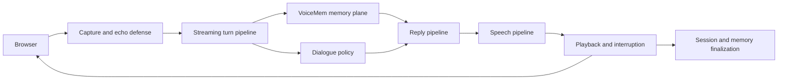
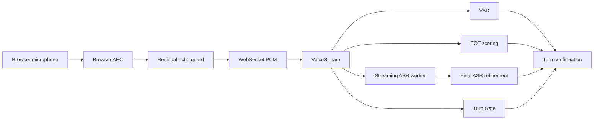
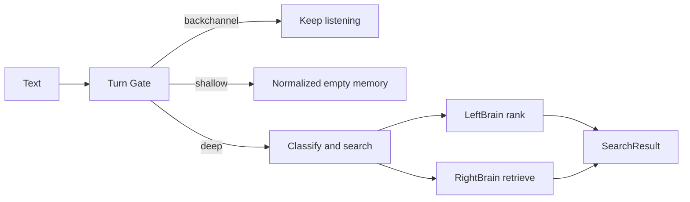
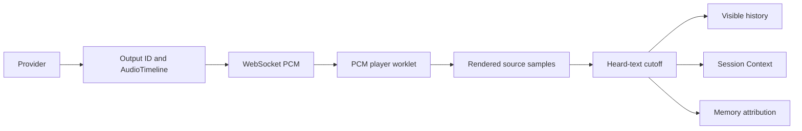

# VoiceMem Studio Architecture

This document describes the current Studio architecture, ownership boundaries,
runtime flows, and extension points. It is a design reference, not a development
log or benchmark report.

## 1. Product scope

VoiceMem Studio is a conversational voice application built around the
`voicemem` memory framework. The repository contains both:

- the reusable memory package; and
- a latency-oriented voice experience with browser capture, turn-taking,
  configurable prompts, local or remote reply models, speech synthesis,
  interruption, and observability.

The memory system does not depend on a particular reply model, speech provider,
or transport. Studio composes those concerns at the application boundary.



## 2. Architectural planes

### Client plane

Owned by `studio/apps/ui/`, `studio/web/transport.py`, and the AudioWorklets:

- microphone permission and browser audio graph;
- browser acoustic echo cancellation;
- residual playback-reference filtering in `mic-capture-worklet.js`;
- WebSocket text, PCM, and playback-checkpoint messages;
- PCM buffering and rendering in `pcm-player-worklet.js`;
- subtitles, Memory Space controls, and memory visualization.

The client reports rendered source-sample progress. Network receipt does not
mean that audio was heard.

### Conversation plane

Owned by `studio/core/voiceagent.py`, its `utils/` modules, and `studio/harness/`:

- turn lifecycle and session wiring;
- unfinished-utterance handling;
- spoken backchannel policy and cached clips;
- tone-label parsing and TTS instruction selection;
- allowlisted, conversation-scoped Self Harness overlays selected by the reply model;
- early reply buffering and commitment;
- interruption and output cancellation;
- short-term Session Context.

This plane may use memory results but does not define factual or affective
storage semantics.

The four policy files in `studio/harness/{persona,speaking_style,reply_modes,
turn_taking}/policy.py` are immutable runtime defaults. Each exposes its
pre-Self-Harness prompt as a `DEFAULT_*` value, and execution remains in the
corresponding `studio/core/utils/` component. The editable Harness catalog has
Chinese and English default templates with the same dialogue and control
protocols; English defaults live in `studio/harness/prompts_en.py`. A shared
persona rule permits natural Chinese/English conversation, mixed terminology
and explicit user language requests. No ordinary per-turn system message forces
a reply language. `--lang` supplies an initial UI/default
language. The browser's base-language choice supplies the connection fallback
for ambiguous first inputs, default Harness templates, and the opening; stored Space language remains the
fallback for clients without that choice. Neither restricts speech or stored facts.

`studio/harness/self_harness/policy.py` is the fifth, coordinating policy. It
declares a typed overlay schema spanning persona interaction style, speech rate,
tone, reply length, reasoning depth, spoken backchannel frequency, and work
filler behavior. The same reply call emits a private `<self_harness>` JSON
prefix before its tone tag. The reply pipeline removes that prefix, rejects
unknown domains, fields, values, and changes larger than two fields, and stores
accepted changes on the current WebSocket `Conversation`. It never rewrites the
four default prompts, Python source, provider settings, or arbitrary runtime
parameters.

Self Harness changes are small session overlays. The model may emit them only
for explicit user preferences; transient content cannot change the profile.
Current profile context marks fields changed during the preceding two replies.
A conflicting request in that window is emitted as a candidate but staged by
the runtime instead of being activated. The model asks for confirmation; only
the same candidate repeated on the next explicit request is applied. This
hysteresis is enforced for the stored profile and the current reply's TTS, while
relative speech-rate requests move only one step. The runtime also enforces the
schema and per-turn change bound independently of the prompt.
Speech rate is appended to request-scoped TTS instructions, reasoning preference
is composed with Gate memory eligibility, and turn-taking preferences mutate
only the session state machine. Speculative replies stage their entire update
and apply it only when that reply is committed, so a discarded EOT prediction
cannot alter later turns. Realtime speech-to-speech prompts do not use this text
control protocol.

The owning browser can read and change the same profile through
`self_harness_get`, `self_harness_update`, and `self_harness_state` WebSocket
messages. Profile controls expose enum values and display labels. The separate
Harness editor exposes an explicit default-prompt catalog and validated text
overrides to the owning browser. Model control headers cannot edit these strings.
Ordered enum fields are shown as discrete slider
stops; unordered enums use ordinary choices. An explicit settings choice applies
immediately, while later conflicting model changes still use the confirmation
window. The legacy `harness_prompt_update` Persona supplement remains supported
and is appended as a user instruction. Batch `harness_prompts_update` messages
replace the session's explicit prompt overrides atomically; defaults on disk
remain immutable. A matching request ID acknowledges acceptance or validation
failure through `self_harness_state`.

The local Qwen3-0.6B classifier selects ordinary or deep reasoning after ASR.
Studio combines that depth with VoiceMem memory eligibility into the existing
`fast`, `medium`, or `slow` reply modes. Missing default weights are downloaded into the
`studio/models/reply-router/Qwen3-0.6B` directory with visible progress.
Explicit model paths remain caller-owned.
Default waiting speech is prepared independently; warm cache hits do not invoke
the router or synthesize speech again. Explicit custom filler prompts retain
the selected router's short-text generation contract.

`studio/core/core.py` exposes service setup and the chronological controls:
listen, merge continuation, stop warming, wait on unfinished speech, route,
interrupt, commit early output or start a reply, and cancel on disconnect.
`VoiceAgent` composes application utilities. `Conversation` owns per-WebSocket
state and tasks explicitly; utility methods implement each control without
moving model inference onto the event loop. GPU and Torch schedulers remain
process-scoped. Speculative generation captures its memory instance and space
before scheduling; cancellation also reaps pending route work.

The native Mac App's first local launch chooses the VoiceMem memory API, prepares the
memory-stage models, then chooses the Studio Agent reply API. It passes separate
`--memory-llm` and `--llm` values into one Studio backend. The direct Python CLI
retains its simpler compatibility behavior: an interactive launch without
`--llm` asks once for DeepSeek, Qwen, OpenAI, or an MLX-local reply model;
remote selections are also used for VoiceMem memory work, while local replies
default memory work to DeepSeek. Explicit `--memory-llm` and `--llm` select
the roles separately. `--check`, explicit provider flags, realtime mode, and
non-interactive commands do not prompt. Non-interactive startup defaults to
DeepSeek reply, Breeze TTS, and the `studio-zh` Memory Space.
An explicit `--space` selects another existing or new space; stored language and
memory data are preserved when the default selection changes.
Without `--memory_root`, each selectable Space owns its existing named directory
under the repository memory parent. An explicit `--memory_root` preserves the
VoiceMem contract of one exact database directory, not a parent for new Spaces.
Studio binds that directory to the startup `--space`, reads its existing metadata
and counts, and rejects creating or selecting another Space. The browser exposes
this fixed selection and hides new-Space controls. Existing memory is neither
moved nor rewritten to introduce child directories.
Qwen is selectable with `--llm qwen`: `qwen3.6-flash` uses the international
DashScope OpenAI-compatible endpoint with streamed content and request-scoped
thinking. Credentials come from `DASHSCOPE_API_KEY` or ignored `.env.qwen`;
ordinary replies disable thinking, while deep reasoning preserves the router's
selection. Memory workers and display rewriting use the selected memory model.
Startup reports missing credentials, dependencies, versions, assets, policies,
and weights before opening memory.
Repository `.env` files supply credentials and deployment options without overriding
exported environment variables. Both platforms use `python -m studio` after
activating their separately installed environment; `python web/run.py` remains
the compatibility entry point. `studio/scripts/run_cuda.sh` and
`studio/scripts/run_mlx.sh` select the corresponding interpreter and backend;
the root `scripts/run_studio_*.sh` paths are compatibility wrappers. They
enable verbose terminal logging, and forward arguments to that same entry point.
The backend defaults to CUDA on Linux and MLX on macOS, with CUDA devices
defaulting to `cuda:0`. Environment variables and explicit CLI flags remain
optional overrides for the backend and ASR/router or TTS device. Complete legacy weights are linked
into `studio/models/`; missing artifacts download there with resumable caching.
The DeepSeek provider is also passed into VoiceMem's internal extraction,
annotation, and cleanup workers, so their model and endpoint cannot fall back to
an OpenAI model name.
The MLX extra pins Transformers 5.16.1 with Hugging Face Hub 1.x to satisfy
MLX Audio 0.5.1. The separate CUDA extra pins Torch 2.8.0, Transformers 4.57.3,
Hub 0.x and qwen-tts 0.1.1 for the native Breeze streaming runtime.
The memory package accepts Transformers 4.52.3 through 5.x;
its recognition and reply contracts remain unchanged.
Selected model warmup failures prevent serving a silently degraded pipeline.
`--check` performs inspection only. Model directories contain weights, while
model classes and factories live in `core/utils/<component>/`.

### Deployment boundary

The Python wheel distributes the VoiceMem SDK, sample audio and runtime prompts.
Studio Python helpers remain included for existing SDK speech-provider and default
persona imports. The complete Studio application runs from a repository checkout;
its UI, avatar assets and model weights are not wheel resources. Package-data
patterns deliberately exclude partial Studio frontends and reviewed Studio voices.

Native Apple Silicon setup installs the Studio extra with
`studio/constraints-macos-py312.txt`, a Python 3.12 profile pinning direct and
transitive dependencies, then runs `pip check`. It does not apply these Mac
constraints to the independent CUDA profile. Local runtime logs under
`prompt/logs/` remain ignored.

Linux/NVIDIA deployment uses the root compatibility `compose.yaml` and
`studio/deploy/Dockerfile.cuda` to run
the same Studio entry point and in-process Breeze provider. The image pins the
independent Breeze source revision and CUDA dependency profile. The default
image tag is `voicemem-studio:torch2.8-cu128`, with Torch/TorchAudio 2.8.0,
TorchVision 0.23.0 and CUDA 12.8 validated during the build. The host retains
ownership of its NVIDIA driver. Model weights are acquired at runtime.
Only GPU 0 is exposed to the container. The process
runs as a non-root user with an init process; memory, results, request logs,
model weights and compiler/download caches live in separate persistent volumes.
The harness directory and TTS JSON are read-only configuration mounts, loaded on restart.
Credentials are runtime configuration, never image build inputs. Build-context
filters exclude private traces, memory, recordings, checkpoints and host environments.
The default published port is loopback-only; exposing the application requires
deployment-level HTTPS and access control. HTTP health becomes available only
after the existing model warmup completes.
Native command-line startup also binds loopback by default. The CUDA container
explicitly binds `0.0.0.0` inside its isolated network namespace so Compose can
publish the service on the host's loopback address.

Apple Silicon retains native MLX deployment through the existing launch script;
`studio/scripts/setup_mlx.sh` prepares the matching environment without replacing
an existing environment or credential file. No Metal-in-Linux-container path or
host inference proxy is added. Neither deployment changes memory semantics,
provider contracts, speech segmentation or model scheduling.
`npm start` is the canonical source entry and runs local Python setup after the
VoiceMem API choice, only when the environment marker is absent or the dependency
definition changed. `studio/scripts/start_app.sh` owns the Mac App shortcut;
`scripts/start_studio_app.sh` and `scripts/setup_studio_mlx.sh` are compatibility wrappers.
The lower-level backend launchers remain
available independently.
The native setup also installs the locked desktop-pet dependencies. Headless
containers disable spawning Electron through `STUDIO_DESKTOP_PET=0` while
retaining the upstream pet-observer WebSocket and events. Linux, including WSL,
never auto-spawns the desktop pet even when the environment flag is enabled.
Native macOS launches keep the optional automatic pet lifecycle by default.

`studio/core/voicemem.py` is the integration boundary for creating VoiceMem and
opening its native stream; Studio perception obtains VoiceMem's process-shared
embedding model through the same bridge rather than importing the Web transport.
The current deployment is one process: memory is
initialized before Studio starts accepting connections. There is no memory RPC
server or second startup command. Streaming ASR, final ASR, VAD, EOT, and their
worker/epoch guards remain in VoiceMem because the memory package also uses them.
`studio/core/utils/asr/` initializes shared recognizers from Studio weight paths.
`studio/paths.py` owns Python resource lookup: reviewed voice assets are in
`studio/resources/voice/` and pet assets are in `studio/pet/`; legacy repository
siblings remain a compatibility fallback. The repository root still owns runtime Memory Spaces,
results, and legacy model reuse, while weights default to `studio/models/`.
The startup loader reads `.env` before importing `studio.paths`, so optional
model and voice directory overrides are effective on a fresh process.
Studio-owned prompts use `studio.prompt_config` as their path authority;
Studio startup inspects that effective prompt directory rather than assuming
the repository root. The desktop pet preparation follows the same Studio-first,
legacy-second source rule. The App-managed Python backend requires the package
entry point and root package metadata, while Docker startup separately requires
Compose; local MLX/WSL startup is not coupled to a Studio Compose file.

`studio/web/` owns browser assets, HTTP/WebSocket transport, and the desktop
pet bridge. Startup rejects the unsupported `STUDIO_PUBLIC_DEMO` flag before
loading dependencies, models or Memory Spaces.

In Studio `llm_tts`, a stranger turn excludes retrieved memory and recent
session messages from the reply request. The speaker gate's identity decision
stays in server state and diagnostics; it is not included in reply prompts.
The gate also skips or discards speculative replies before playback. Background
ingestion and speaker tracking keep their lifecycle so a later matching voice
can clear the gate.

`studio/apps/` owns the Windows/macOS Electron desktop client and pet. Linux is
a backend deployment target, not a desktop release target. Windows runs capture,
playback and the pet natively, while local CUDA inference belongs in WSL2 or its
Docker backend.

Windows source `npm start` uses the Docker route: it validates the local named-pipe context and Linux engine, fills missing memory/reply credentials in the ignored project `.env`, builds the Studio image only when absent, starts Compose, and waits up to 30 minutes with terminal logs before handing the discovered loopback URL to Electron. Existing settings and comments are preserved; Docker credentials are plaintext deployment configuration, distinct from native safeStorage. Docker containers and named volumes remain independently owned and are not stopped when the App quits. The existing WSL Python adapter remains available internally but is no longer the Windows source default.
Explicit `start:remote` bypasses Docker and ignores any inherited automatic server URL. macOS uses native MLX or a remote service. Both clients share
the same Web UI and observer contracts. The backend root serves the shared
frontend from `studio/apps/ui/`, with assets under `/ui/`. Its first page is a style-selection homepage, with labeled
image cards linking to the technical or digital-human visual style and a shared
base-language selector persisted with display preferences.
Digital conversation bubbles place per-turn perception labels in a collapsed
native disclosure. Late label updates preserve its open state. These labels
describe retrieval/perception metadata, not a memory-store acknowledgement.
Shared `design.css` tokens own the light and dark control palette, typography stack,
corner radii, and style-preview cards used by the homepage, settings, and desktop
connection page. Settings, Space pickers, and memory dialogs inherit the active
page theme while each conversation view retains its own scene and layout. On
narrow screens, the technical view stacks perception above the conversation or
memory panel and presents its conversation list as an overlay. A centered
settings shell lives inside each style, with an icon sidebar for appearance,
text, conversation preferences, Harness prompts, and components. The conversation panel mirrors
Self Harness snapshots, with the fastest existing speech-rate preset as the
new-session default. The Harness panel owns free-text Persona editing;
speech rate, tone, and waiting feedback use fixed-choice selects, while reply
length and reasoning depth use segmented choices from the same bounded schema. Backchannel frequency uses a
four-node curve editor whose nodes are the expected acknowledgement quotas for
the 0–3s, 3–6s, 6–10s, and 10s+ speech phases. Fractional values are sampled to
integer per-turn targets while preserving their expectation; the shared
first-six-second cap and the refractory cooldown still apply. Preset Self Harness
values provide the initial curve, while an explicit user curve is scoped to the
current conversation and is reflected in subsequent snapshots. The component
settings tab presents input, memory, reply, speech, turn control, and pet as a list with shared
icons and provider labels. Selecting a row opens its configuration; returning
restores keyboard focus to that row. Components cannot be removed, and this
panel does not write layout preferences. `/ui` responses use `Cache-Control: no-store`, and the entry pages
version their settings assets so an Electron reload cannot retain an older
settings implementation after an update. `/api/components` supplies non-secret provider, model, endpoint, and
readiness labels. For an App-owned backend, a narrowly scoped isolated preload
allows the main-frame settings page to stage multiple component changes and
apply them with one supervised backend restart. Current model selections remain
the recommended defaults. Memory and reply retain their supported Chat API
providers; streaming ASR also supports Deepgram Listen v1, and speech supports
the existing OpenAI-compatible PCM adapter. Advanced component selections use
explicitly installed Python factories with checked Harness contracts. The main process validates endpoints,
keeps keys out of command arguments and backend responses, and encrypts persisted
keys with Electron `safeStorage`. A new configuration is persisted only after its
backend becomes ready; failure restarts the previous configuration. Startup
exercises the selected components, and changed remote memory/reply services
receive a disposable streaming connection check without conversation or memory
context. Draft keys remain only in the settings instance until submitted; public
manifests never contain keys. Existing or
remote services remain read-only because their lifecycle belongs to the server.
Before replacing an App-owned backend, Electron waits for the old child to exit
so the replacement does not race it for port 8787. Failed replacements also
exit before the previous configuration restarts. The managed server bounds
Uvicorn's graceful shutdown while the old UI still has an open WebSocket.
Electron force-stops only its own child if it remains after that grace period;
if the child still does not exit, the old configuration stays selected and no
replacement process starts.
`/legacy` retains the previous Studio renderer;
`/classic` retains the older demo. The desktop opens this same root and keeps its
connection configuration window hidden on a successful startup; connection errors
reveal configuration. Desktop clients require the updated backend assets.
Electron owns the initial and style-navigation window bounds through
`studio/apps/window-layout.cjs`. Home opens at 720×560 and conversation views
prefer 1440×920; both are centered and constrained to the current display's work
area. Short browser viewports use compact homepage previews and spacing.

`studio-client.js` owns one page-local WebSocket and AudioContext, reuses the
existing capture and PCM AudioWorklets, and sends rendered-sample checkpoints,
actual playback RMS levels, pause/resume, and filler completion on the existing
protocol. The RMS event feeds the App-owned Live2D pet and is not treated as a
playback checkpoint. The client retains a bounded, memory-only PCM cache for
completed replies so the reply speaker control replays the audio that the
backend actually generated. When the user starts the microphone, the client
sends `conversation_start` after capture is ready. The server generates at most
one short opening per WebSocket session through the normal reply and TTS stream;
text sends and settings connections do not trigger it. The opening may draw on
low-sensitivity facts from the current Space, and falls back to an ordinary
greeting. The model selects a tone for the opening from those facts using a
detached auto-tone snapshot. This tone neither updates Self Harness nor
participates in the cross-turn tone smoothing used by later replies. Only its
heard assistant text enters the session context; it creates no user transcript
or long-term memory ingest.
The opening explicitly uses the selected base language, even when retrieved
facts use another language. This constraint applies only to the opening;
subsequent replies follow actual input and explicit language requests.

Interrupted replies retain only the source samples
reported as rendered by the playback worklet. Replays do not emit playback
checkpoints and the cache is discarded on page refresh. UI replies and
perception come from backend events. Confirmed input IDs deduplicate transcripts
and merge continuations; interruption uses the backend's heard prefix. Streaming
reply deltas update the active text node without rebuilding prior chat turns.
Both styles use `transcript.js` to reconcile message objects with stable bubble
nodes, retain the unchanged ASR prefix while updating its tentative tail, and
coalesce scroll following while respecting readers who have scrolled upward.
Only newly inserted bubbles enter with an animation; transcript and perception
updates do not replay animations on existing turns.
Changing style, conversation, or leaving the page closes its connection. UI
language changes retain the connection and do not reopen or rewrite memory. Chat
lists are page-local and reset on refresh; opening a previous list item starts a
new backend context for subsequent input. Both styles let each new chat choose a
Memory Space. Chats retain that choice and share the Space's persistent memory;
switching chats selects the corresponding backend Space before further turns.
The technical and digital-human pages render assistant Markdown
through one DOM-only preview, including headings, emphasis, lists, quotes, links,
tables, code and delimited LaTeX math. Math is recognized before Markdown escapes
or emphasis so `\[...\]`, `\(...\)`, `$$...$$` and `$...$` retain their commands
and subscripts. Fences labelled `math`, `latex` or `tex` also use math layout;
ordinary code, escaped dollars and currency remain literal. A vendored KaTeX
0.18.10 runtime, stylesheet, fonts and license ship with the UI; users do not
need a browser CDN or an additional npm install for formulas. KaTeX receives untrusted input with resource/HTML commands disabled, fresh macros
per expression, bounded expansion, bounded size and an 8192-character input
limit. Incomplete streaming math waits for closure; malformed final input falls
back to text without failing the reply. Up to 128 rendered expressions are
cached in the page to avoid repeated parsing of unchanged formulas on each
streaming frame. Formula base size inherits the reply font; superscripts and
fractions retain their mathematical proportions, and wide display formulas
scroll inside the reply. Root containers retain their page-specific typography; nested
paragraphs, headings, code and tables inherit the existing font size and line
height. Desktop reading-size rules target the reply root, not nested Markdown
paragraphs, so the common stylesheet cannot enlarge only part of an answer.
Browser text-size adjustment is fixed at 100 percent to prevent independent
mobile block inflation; user zoom and content-size settings remain available.
Heading weight distinguishes sections without enlarging subtitle text.
Raw HTML remains text, images display their alt text, and only HTTP, HTTPS or
mailto links are clickable. Streaming paints coalesce per animation frame;
completed blocks separated by a terminated blank line retain their parse and
DOM nodes. The active block patches its existing DOM, and the live caption and
history share the latest immutable parse plan with independent DOM ownership.
Live reply appends fade in only the newly visible text over a short opacity
transition. Existing text stays opaque, temporary inline wrappers are removed
before reconciliation, and completion or interruption cancels stale reveals.
History restoration and reduced-motion views render without this transition.
Unchanged history bodies skip parsing; completion/reset cancels stale paints.
User transcripts remain plain text, and
copy/history retain source Markdown. Interrupted previews render the heard
prefix without requiring closing formatting markers.
The brain backdrop remains an illustration, while graph nodes are rebuilt from
the current Space's `/api/memories` snapshot. Both visual styles share the
server's asynchronously prepared portrait labels, including the existing
owner-name policy. The shared renderer supplies `lang=en|zh` to `/api/memories`,
including its full-list form. The transport's optional `localized_snapshot`
callback captures this display language without changing the Space or process
language; legacy snapshot injections keep their no-argument contract. Label
preparation captures the owner and display language, requests that output language
explicitly, and caches the result by language, owner and claim. UI domain labels,
canonical emotion labels and card chrome are localized; original facts, evidence,
proper names and stored claims remain unchanged. Language switches invalidate
in-flight graph/full-list reads and refresh the localized projection.
Right-brain items retain the stored claim in `raw` and expose
`label_pending` alongside `text`. The server captures label text and readiness
together and deduplicates concurrent preparation; a failed rewrite resolves to
the stored claim for that process. The shared graph renderer refreshes pending
labels until ready, including on initial load, so page-open order cannot leave
one style displaying an earlier label. The display owner name projects the newest
explicit persisted owner-name fact, with voice registration as a fallback; this
does not alter voice identity binding or stored history. Revisions and registry
modification time invalidate the name cache. No model call blocks the conversation
or the WebSocket loop. Node placement uses the visible
hemisphere bounds and keeps space between memory nodes and domain labels on
each resize. Hovering or selecting a node shows
a compact card beside it, following the Web brain's interaction pattern.
Both styles observe `/ws/memories`, a passive subscription to one captured Space.
Committed changes trigger a fresh snapshot regardless of reply timing. Notifications
coalesce, reconnects receive the current revision, and a process epoch distinguishes
restarted revision counters. Hidden/departed pages unsubscribe; Space changes and
request ordering reject stale results. Graph snapshots include their Space, epoch,
revision and totals. Recently changed records take priority within graph limits;
`/api/memories?all=true` supplies the shared full-list dialog using the store's
enumeration limits, without starting extra portrait rewrites. The digital stored-memory
panel consumes these same snapshots and ignores label-only changes. The graph
redraws when displayed content changes, including evidence or deletions. Its
background canvas is redrawn on resize or view changes rather than every frame.

The technical page's liquid orb owns its WebGPU device and animation loop.
The shared client's live phases drive its actions: listening keeps the interior
flow active even between microphone level reports; actual playback drives a
vertical speaking rhythm. Either thinking phase lowers the orb and holds it
there until that phase ends, then a damped spring returns it to center. Switching
between short and long thinking preserves the lowered position. Reduced motion
disables the travel and continuous flow. These actions use the existing render
loop and do not affect audio, model scheduling, or reply timing.
Transient adapter, device or rendering failures show the existing static preview
and allow at most three delayed recovery attempts per foreground visit. Recovery
retains the current voice state and motion parameters. Unsupported WebGPU and
shader compilation errors do not retry. Hidden, offscreen and settings views
pause frames and pending retries. Page departure releases the device and uniform
buffer, invalidates asynchronous initialization callbacks, and a restored page
reinitializes on demand. The shader and voice-state motions are unchanged, but
rendering is capped at 30 frames per second during active states/transitions and
12 when settled at idle. Render density is capped at 1.25 and dimensions at 384
pixels. A queue-completion fence permits only one outstanding submission from
the orb; stalled GPU work does not accumulate animation frames. Stale completion
callbacks cannot restart an abandoned device or hidden view. Adapter selection
requests low power, and phase text follows the UI language.

The panels show real per-turn recall results without demo records or rule replies. A local
configuration page owns connection IPC. The Studio renderer has only the model-service
bridge described above and no Node integration. Both renderers use context isolation and
sandboxing. Microphone requests are limited to main-frame audio from the selected
origin and require user approval; remote connections require HTTPS, while HTTP
is accepted only on loopback. Settings and browser state live in the desktop
application-data directory, not in the backend's memory or credential files.

The source desktop entry (`npm start`) first verifies its locked Electron, PixiJS,
and Pixi Live2D files. Missing packages trigger `npm ci --include=dev`; after
that, a missing Electron binary runs Electron's installer explicitly, since the
package does not declare an npm install script. A complete
installation performs no package-manager or network work. The managed install
explicitly enables lifecycle scripts so a user-level npm `ignore-scripts`
setting cannot leave Electron without its platform binary. It then owns an optional local backend lifecycle.
The separate `npm run start:remote` entry performs the same locked client-resource
preparation but removes managed-backend state before Electron starts. It opens
the connection configuration with an empty, required address, without first
waiting on the default loopback service and without checking local Python, WSL, accelerators,
credentials, or inference models. This is the source entry for Intel Macs,
clients without a compatible local GPU, and already running local or remote services.
Without encrypted App model configuration, local startup first selects the
VoiceMem memory provider and reads its key through masked terminal input, then
prepares the missing or stale Apple Silicon Python environment. A short-lived
preparation process checks and acquires the shared memory,
perception, and transcription models. Keys are inherited only by preparation,
Electron, and the backend process, never command arguments. After preparation,
the user selects the Studio Agent's dialogue-model API; a different provider
or endpoint requires its own masked key, while the same service reuses the
memory key unless a separate reply key is configured. Native source startup
loads repository `.env` and `.env.qwen` values before the terminal prompts,
preserving exported-variable precedence and carrying the resolved configuration
through Electron to the backend. Blank input retains an available key; without
one, the terminal asks again before preparing models.
The last menu option clears managed state and opens only the connection page;
the address is required before the style selector. This is not a second reply
service: VoiceMem's selected API is used for memory work, while Studio owns
the complete agent (memory integration, ASR, dialogue, TTS, and UI). The `start:remote` shortcut
avoids even the memory preparation. VoiceMem initialization remains inside the
eventual Studio backend, not a second service. Later managed launches reuse
complete App configuration without another terminal prompt. Missing saved
memory or reply keys are collected through masked terminal input for their
existing endpoints. Electron applies these keys only to missing credentials
whose provider and endpoint match, preserving saved models and other components,
and persists the repaired configuration only after backend readiness. The source
launcher does not decrypt saved keys; Electron remains the secure-storage owner.
After the first backend reaches readiness, Electron persists keys only through OS-backed
`safeStorage`; the connection settings file remains secret-free.
Electron starts `.venv/bin/python` with the MLX backend on macOS, or invokes
`.venv-cuda/bin/python` through `wsl.exe` with the CUDA backend on Windows. Both
paths prefer loopback port 8787 and select an available loopback port if it is
occupied. They disable the backend-owned pet, acquire the
remaining reply and speech models, run strict warmups, wait for the shared Web
page for up to 30 minutes by default, and only then create and show the style selector.
The managed backend echoes a per-launch instance ID on the Web root response;
the App accepts readiness only from that instance and reports an occupied port
if another service wins the selected port before startup completes. Existing-service
connections do not require this instance ID.
During managed model-service changes, the App retains ownership of the old
backend until it exits and prevents connection actions from cancelling startup
or restart. App exit signals either the running or stopping owned backend.
The timeout can be increased for unusually slow first downloads through the
desktop launch environment. Existing-service connections retain their shorter
readiness timeout. Managed startup never
creates the local connection/status window; preparation progress stays in the
terminal, and startup failures use a native error dialog. The app stops this
owned process on exit. Missing Python, WSL, driver, or dependency prerequisites produce a startup
error; model artifacts are checked and downloaded with resumable provider
caches. The desktop entry does not install or modify system components.

Studio's main-thread entry converts the default SIGTERM action into a normal
Python exit. Uvicorn retains signal handling during serving and completes its
graceful shutdown before replaying the signal; TTS cleanup and Python resource
finalizers can then run. The same handler covers interruption during preparation
or warmup, preserves caller-installed handlers, and restores the original handler
when the entry returns. App restart keeps its existing timeout and forced-stop
fallback.

On Windows, an opt-in configuration setting can also start an existing local NVIDIA
Compose service through a local Docker named pipe. Docker Desktop must already
be running with its WSL2 backend; the app never starts or installs the Docker
engine or WSL itself. The Unix-socket path remains available to isolated Linux
development tests, not as a Linux desktop release. Startup uses the user-approved project and optional local override,
never builds or pulls an image or recreates an existing container, reads the published port and waits for the Web
page to become ready. Connection attempts own cancellable CLI and readiness
work; stale attempts cannot replace a newer window. Closing the app never stops
the shared container. Installed desktop packages can still connect to an already
running local or remote service; the source-managed backend requires the repository
and its prepared Python environment. There is no Metal-in-Docker path. Desktop packages contain the shell, Electron
runtime and pet display resources, not inference weights, Python, recordings,
credentials or memory data.

The desktop app also owns one optional transparent pet window in the same
Electron application. Packaging selects the `studio/pet/` renderer, animation,
observer, rattan/white-vine Cubism model, expressions and Pixi runtime without forking them or
bundling another Electron. The generated HTML connection CSP is adapted for the
desktop package, and the pet session permits the Cubism Core source plus the
selected observer. Resource preparation backs up recognized Canvas and older
Live2D build output before migration, excludes backups from the package, and
rejects unknown files. Its isolated preload exposes window controls,
not Docker or settings APIs; IPC validates the pet's exact main frame and document.
The pet session permits bundled resources, the Cubism Core source and the selected
`/ws-pet` endpoint and denies device permissions. Its call button sends a trusted,
main-frame-only IPC request to toggle the existing Studio page's voice control with
a user gesture; the App renderer retains microphone permissions, capture, playback,
and conversation ownership. Desktop voice capture may continue while the App window
is hidden. Opening settings pauses microphone capture but retains the current
WebSocket so session preferences can be read and changed; page navigation and
explicit stop still end it. Service changes close
the old observer before opening the new one; closing the Studio window closes the
pet. Position and a 40–150% expanded-window scale live in desktop app data; older
position-only files default to 100%. The shared renderer uses a portrait call
background, a single voice toggle and a collapse button, without numbered action
controls. Dragging any of its four corners resizes around the opposite corner, and
dragging the character or background moves the window. Window controllers constrain bounds to
the display work area and resize without restarting the avatar pose. The dot
keeps its fixed size, and manual collapse suppresses observer-triggered expansion
until the user explicitly reopens it. Opening or focusing Studio leaves pet
placement under user control. The standalone controller provides the same controls
with its own saved position and scale. Native users can disable the backend's
automatic pet with the existing `STUDIO_DESKTOP_PET=0` to avoid duplicate windows;
containers already do this. The standalone launch and Web playback contracts remain unchanged.

Original `web/run.py` remains a thin compatibility entry point. Studio-specific
implementations have one owner under `studio/` and callers import them directly.
The old top-level `harness/` forwarding package is removed: Studio policies
are imported through `studio.harness` only. Studio-specific offline speech/TTS
development scripts live in `studio/tools/`; they are never part of startup.
The root `web/` compatibility launcher stays separate from VoiceMem's own Web
demo and is not a directory to copy wholesale during migration.

### Memory plane

Owned by the reusable `voicemem` package, following upstream module boundaries:

- `core.py`, `config.py`, `__init__.py`: public facade, configuration and lazy exports;
- `orchestrator.py`: cross-component search/ingest, capabilities and `SearchResult`;
- `stream.py`: ASR workers, turn snapshots, confirmation and speculative retrieval;
- `gate.py`: memory eligibility and interruption routes;
- `lang.py`, `llm_config.py`: language context and process-wide model roles;
- `reply.py`, `tts.py`, `audio_timing.py`: shared reply/speech adapters and contracts;
- `startup_check.py`: optional capability probes;
- `leftbrain/`, `rightbrain/`: factual and affective memory;
- `memory_api.py`: prompt-ready memory helpers.

These files contain their implementations directly. There is no module redirection
layer or parallel runtime/input/output package tree. Search, ingest and streaming
retain their original state, locks, executors and cancellation boundaries.

`leftbrain/memory_repository.py` owns backend writes, the Space mirror and
maintenance APIs. `memory_repository_v2.py` extends those writes with slot metadata
and summaries; it is an implementation, not a second independent memory engine.
`LeftBrain` continues to own classification, candidate expansion and ranking.
The extension selects its graph-store type before construction so base schema
initialization and migration run once. Existing tables and query algorithms remain
unchanged. See `voicemem/README.md` for the owner inventory and historical opt-in APIs.

`utils/common/memory_changes.py` owns process-local revisions per resolved Space
root. Native factual mutations and trait/evidence transactions publish after a
successful commit; repository and slot-extension completion publish after metadata
updates, including with injected vector stores. Ingest completion provides a final
notification after auxiliary writes, including empty or failed background completion so partial
success can be reread. Recent changed IDs are bounded advisory display state;
neither revisions nor listeners are a persistent journal or a retrieval policy.
Listeners run outside the revision lock on the writer thread and only schedule work.
The transport uses a bounded queue and removes listeners and publisher tasks on
disconnect. Reading snapshots and persistence remain outside the WebSocket loop.

`leftbrain/mem0_backend_store.py` caches one Mem0 client per resolved local
Qdrant directory. Before sharing it, the adapter serializes native Qdrant SDK
operations with one client-owned reentrant lock, also used when Mem0's entity
store reuses that client. Searches cannot observe vector and payload arrays
halfway through a write. Embedding, extraction, BM25 encoding, Mem0 history,
and result reranking stay outside this boundary. Each native operation releases
the lock; a multi-fact background ingestion does not hold it across the batch.
Different directories have independent locks. A contending query can wait for
an in-progress native operation; this does not guarantee zero additional latency
or make embedded storage safe for access from multiple processes.

The repository's historical `search_with_graph()` and `search_combined()` are
deprecated and unsupported. Direct calls immediately raise `NotImplementedError`
and direct callers to `VoiceMem.search()`; they do not query stores or start work.
The optional fusion adapter falls back to its existing plain search only when a
graph provider explicitly raises `NotImplementedError`. Custom graph providers
remain supported. Studio's cognitive-graph, ranking and dual-brain search flow
does not call these legacy entry points and remains unchanged.

### Inference and scheduling plane

This is shared Harness runtime infrastructure, independent of dialogue policy,
memory semantics and platform-specific model implementations. Studio composes
it through `voicemem.engine`; the reusable SDK can use it without importing Studio.
Owned by provider modules and shared schedulers:

- `studio/core/utils/llm/local.py`: local MLX reply generation and prefix/KV caching;
- `voicemem/tts.py`, `studio/core/utils/tts/component.py`, `cache.py`: speech providers and local
  synthesis support;
- `voicemem/engine/`: shared inference execution and resource scheduling;
  `backends/` owns the MLX execution thread and cooperative prefill, CUDA speech
  workers, Torch per-device locks and CPU thread budgets; `scheduling/` owns
  priority contexts, speech-aware cross-backend admission and background native
  task lifetime and replaceable CPU probes; `telemetry/` owns adapter timings and
  OS/device observations.
  Provider consumers use the public `voicemem.engine` facade;
- `voicemem/utils/engine.py`, `gpu_loop.py`, `torch_lock.py`, `background.py`:
  compatibility imports exposing the same engine-owned objects;
- the streaming ASR worker and dedicated final-ASR executor in `voicemem/stream.py`.

Provider adapters translate configuration and provider events into shared
reply, text, PCM, and timing contracts.

### Configuration and observability plane

Owned by:

- `studio/harness/`: Studio Web persona, context directives, and dialogue
  controls;
- `studio/prompt/llm_*.md` and `studio/prompt/llm_context.json`: package/default LLM prompt
  inputs;
- `studio/prompt/tts.json`: TTS tone and backchannel synthesis configuration;
- `studio/prompt_config.py`: validated Studio prompt loading and caching;
- `voicemem/utils/common/prompt_trace.py`: shared asynchronous request tracing;
- `studio/core/utils/logging_utils/component.py`: runtime log routing;
- `studio/core/utils/latency.py`: confirmed input/output stage correlation;
- `tests/`: deterministic regressions and shared synthetic fixtures;
- `evals/`: manually run latency and model-quality evaluations.

Prompt traces may contain complete conversation and memory context. They are
runtime data even though their schema is part of the observability design.

Confirmed `Turn` and Studio `Pending` objects may carry numeric input-stage
timing. Capture adds archival/handoff timing, routing records its own interval,
and each output timeline captures its generation and first-audio timestamps.
On the first accepted playback-start checkpoint, `[lat-breakdown]` joins that
confirmed input with its adopted output, including speculative overlap.
Gate and retrieval are subintervals of confirmation, not extra additive stages.
The row contains only generated input/output identifiers and timing metadata;
it does not expose dialogue or prompts to the client or persistent memory.

## 3. Dependency direction

```text
browser / application
        -> conversation and provider adapters
        -> VoiceMem public API
        -> orchestrator
        -> left brain / right brain / audio capabilities
        -> stores and model adapters
```

Allowed cross-cutting infrastructure includes normalized contracts,
configuration, locks, schedulers and logging. The memory pipeline does not import
Studio. Studio-specific persona, prompt loading, local reply, Breeze and tone
controls are imported directly from their owners under `studio/`. Shared speech
adapters and timing contracts live in `voicemem/tts.py` and `audio_timing.py`.
Their optional Studio providers retain the existing injection and provider cache.
Plain `import voicemem` and importing the API reply module do not load Studio or
models. Using the existing default reply persona loads Studio lazily.
VoiceMem and Studio import `voicemem.utils.common.prompt_trace` directly, preserving
one writer and one task-local trace context.

`studio/core/voicemem.py::open_memory` composes the existing ASR, reply and speech
implementations. Each component's `initialize.py` owns its defaults and construction;
the bridge passes the resulting reply callable and ASR/VAD/TTS factories into VoiceMem.
Replacement implementations use the same contracts:

| Component | Existing boundary | State ownership |
| --- | --- | --- |
| Streaming ASR | `feed`, `flush`, `reset`, `text`; `new_stream` for independent decoders | Decoder state per connection; reusable model weights |
| Final ASR | `transcribe(audio)` | Refinement adapter; VoiceStream owns scheduling and stale-result guards |
| VAD | `is_speech(samples)`; `new_stream` | Fast synchronous detection; decoder state per connection |
| EOT | `score(audio)` and `threshold` | Existing background probe and stale-result guards |
| Thinking router | `classify_async`, `generate_short_text_async`, `warmup` | Shared adapter; Conversation owns route and spoken-filler tasks |
| Reply LLM | Async callable accepting text, memory context and history, yielding text deltas | Request generation; Conversation owns dialogue state |
| TTS | `stream(text, instruction)`, yielding PCM or timed audio chunks | Provider synthesis; Conversation owns playback and interruption |

`studio/apps/component-catalog.json` describes optional bindings and defaults for
both the desktop and backend. `studio/core/utils/component_config/` validates
startup-only `STUDIO_COMPONENTS` selections, imports explicitly selected installed
factories, and checks their existing contracts. Role-specific API keys use
separate environment variables; editable JSON options cannot contain credential
fields. These selections do not mutate active models or conversation state.
Provider credentials, model acquisition and warmup belong to the selected
implementation's initialization, not memory retrieval or turn policy. The model
manifest skips only replaced component weights; memory perception models remain
independently required. Custom native adapters must retain engine scheduling
and existing lock boundaries. Adapter contracts are documented beside the loader.

Deepgram sockets belong to connection-owned ASR workers. The adapter combines
interim and finalized segments into cumulative text, disables provider endpointing,
and leaves final turn confirmation and independent final-ASR refinement to Harness.
Reset discards decoder text and closes its socket; worker shutdown closes the
transport without affecting sibling connections. Network work stays on that
worker. API speech preserves cancellable mono PCM16 at 24 kHz. Closing a shared
speech stream also closes its provider stream. API clients used during startup
are released before the server event loop starts. Speech backchannel caches are
scoped to endpoint, model and voice/configuration. Recommended speech keeps its
reviewed cache-only bank; a newly selected speech provider primes two bounded
backchannel clips, reuses cached clips, and must be ready before startup succeeds.

## 4. Mode and provider model

Three independent choices shape a Studio run.

### Memory mode

| Mode | Memory capability profile |
| --- | --- |
| `left_brain_single` | Factual memory without affective/audio perception |
| `text_mode` | Text memory with affective memory logic |
| `multi_modal` | Text memory plus ASR, voiceprint, and audio perception |

### Reply mode

| Mode | Output path |
| --- | --- |
| `llm_tts` | Reply provider emits text; TTS provider emits PCM |
| `realtime` | Realtime provider emits transcript and PCM directly |

### Provider selection

Studio can select remote or local reply and TTS implementations. Provider
selection changes generation and scheduling details, not Session Context,
memory semantics, output identity, or heard-text finalization.

The local MLX profile has additional scheduling constraints described in
Section 10.

The reusable package targets Python 3.10 or newer. The current Studio local
profile and eval workflow are standardized on Python 3.12.

## 5. Core contracts

| Contract | Owner | Meaning |
| --- | --- | --- |
| `VoiceMem` | `voicemem/core.py` | Public memory facade |
| `SearchResult` | `voicemem/orchestrator.py` | Combined left/right retrieval |
| `Turn` | `voicemem/stream.py` | Confirmed user text and prepared memory |
| `StreamState` | `voicemem/stream.py` | Partial ASR/VAD/EOT state |
| Gate route | `voicemem/gate.py` | `backchannel`, `shallow`, or `deep` |
| `Pending` | `studio/core/utils/contracts/component.py` | Application-ready confirmed turn |
| `ReplySink` | `studio/core/utils/contracts/component.py` | Hidden speculative output timeline |
| `TimedAudioChunk` | `voicemem/audio_timing.py` | Optional PCM text alignment |
| `AudioTimeline` | `studio/core/utils/audio_timeline/component.py` | One output's text/media clock |
| `SessionTurn` | `studio/core/utils/session_context/component.py` | Unpersisted dialogue context |

Shared code consumes these meanings rather than provider-native objects.

Input display messages use an opaque `input_turn_id`, distinct from assistant
`output_id` and persistent history IDs. Capture retains it across partials and
the accepted input, then rotates it for the next turn. An explicit continuation
merge includes `replace_input_turn_id` so the UI updates the original user bubble
instead of guessing from elapsed time. Untagged events retain legacy display
behavior. These identifiers carry no memory-write or interruption authority.

## 6. Input and turn flow



### Capture

Browser AEC is the first echo-control stage. The microphone worklet receives a
playback reference and suppresses only highly correlated residual blocks. The
server-side text guard provides a second defense against assistant or
backchannel echo reaching ASR.

Capture batches target short, regular PCM frames. Capture and playback share a
sample-clock relationship so latency and echo logic can use explicit media
positions rather than wall-clock guesses.

The browser owns one live connection attempt and its microphone resources.
Startup is registered before opening the WebSocket; another start-button click
cancels that attempt instead of creating a second capture. Every asynchronous
startup continuation checks its owner, and late permission results have their
tracks stopped. End/disconnect/page exit invalidates ownership before removing
node callbacks, disconnecting the capture and playback-reference edges, stopping
tracks and closing the owned socket. PCM callbacks use the socket and sample
clock captured by their own attempt, never a later connection. AudioWorklet
module loading may be shared for one audio context, but capture nodes are not.
The ScriptProcessor fallback follows the same cleanup and ownership rules.
Old socket events and cancelled startup-memory responses cannot affect the new
session. This is a per-page guard, not a cross-client or server-wide session limit.

### ASR and final refinement

Studio defaults to X-ASR-zh-en's 480 ms bilingual Zipformer2 transducer,
using locally quantized INT8 weights and one CPU ONNX thread on both platforms.
Chinese, English and mixed speech use the same model independently of UI or
Space language, including explicit language calls to the Studio factory.
Acquisition and strict warmup use the same local profile and required artifacts.
`studio/core/utils/asr/profile.py` pins the official repository revision and
quantization recipe. Its ASR-owned artifact loader downloads FP32 components
and converts constant MatMul weights to signed INT8 in a startup-only subprocess.
A per-profile file lock serializes preparation; isolated temporary builds and
a provenance/size receipt published last prevent incomplete weights from being
accepted. Downloads and successful conversions are cached under the model root.
Conversion dependencies and native session artifacts stay out of the serving
process and working directory. Failures remain visible rather than silently
selecting another model or FP32 runtime.
The Studio adapter preserves natural casing and removes Chinese token spacing.
Flush supplies up to 800 ms of zero-valued right context immediately, crediting
only exact-zero trailing input already fed; it adds no wall-clock silence wait.
It remains idempotent and never closes the decoder, allowing speech to resume
on the same stream. Reset and new connections clear all private tail state.
Each connection owns its decoder stream and cumulative text; model prototypes
are shared across accounts and Spaces. Native streaming decodes report CPU ONNX
runtime through the engine's audio service. Stateless final-ASR weights are
reused as well. Deepgram and injected provider contracts remain independent.
X-ASR is Studio's only built-in streaming model. No local fallback or model
selection is driven by `VOICEMEM_ASR`, `STUDIO_ASR_DEVICE` or
`VOICEMEM_ASR_DEVICE`. The legacy `--asr-device` flag remains accepted for
launcher compatibility and normalizes to CPU. Startup reports the selected
component's actual placement and does not validate unused ASR CUDA devices.
Prototype construction retains the existing CPU device-lock boundary. The
reusable VoiceMem SDK's adapters remain separate from Studio's injected provider;
FunASR dependencies used by SenseVoice and emotion perception are still required.

Streaming ASR runs in a dedicated serial worker so chunk inference does not
block WebSocket input. At turn end, full-audio ASR refinement may run in a
separate final-ASR executor. Epoch checks prevent obsolete worker results from
overwriting a newer turn.
Audio EOT scoring runs on the engine-owned serial CPU executor in
`engine/scheduling/probes.py`, independent of background ingestion and final ASR.
`VoiceStream.feed` polls completed scores without awaiting native EOT work, so
capture can continue receiving and forwarding every frame to streaming ASR.
Each connection owns at most one queued or running probe. Busy input updates
the existing turn buffer; the next admitted probe copies its latest snapshot
instead of queuing old waveform copies. Reset and close cancel unstarted probes;
running native work retains its slot until completion and cannot update a newer
turn. Provider replacement and speech resumption also invalidate obsolete scores.
A newly consumed score may confirm a turn only if its snapshot includes the
latest voiced frame and some silence, and the existing silence floor and
application pause policy both permit confirmation. Cached and speech-only
scores remain private speculation signals. ASR input coverage, model settings
and silence fallback are unchanged.
The recognizer remains serial. Confirmed decodes precede queued speculative
snapshots, and a stream cancels its unstarted snapshots at finalization.
Already-running native calls finish normally; different audio snapshots are
never treated as interchangeable.
Each stream retains at most one successful completed speculative final-ASR
result. Finalization may reuse it only in the same turn epoch, with the same
provider and exactly equal PCM shape, dtype and samples. A streaming-text
fallback is never cached as final recognition. Extra silence, resumed speech,
provider replacement, reset and close prevent stale reuse. A cache hit advances
the streaming decoder epoch just like a full-coverage final decode.
`VoiceStream.prepare_audio` constructs connection-owned ASR and VAD adapters
off the event loop. VAD recurrent state and segment queues are private to a
connection; consumed segments are discarded because capture only needs speech
activity. Built-in recognizers expose `new_stream` for independent decoder
state. Custom injected objects without that method keep their existing object
semantics. Capture explicitly closes its stream and background perception tasks
on completion, error, cancellation or generator closure. Both chained and
Realtime session consumers close their capture iterator explicitly. Worker shutdown rejects
new input, invalidates queued epochs, resolves pending flushes and enqueues a stop
command. An active native call is allowed to return before the daemon exits;
connection cleanup waits only for the existing bounded ASR deadline, never
forcibly interrupts native inference or closes shared weights.

Studio's final SenseVoice recognizer keeps automatic language detection, accepting
Mandarin, English and Cantonese result tags. Nonempty results tagged as another
language or with an unknown tag return no refinement, so the existing stream
flush, frozen speculative snapshot or latest partial transcript supplies the
fallback. This prevents an out-of-scope language result from replacing usable
streaming text without another decode, translation or extra model. The reusable
VoiceMem recognizer remains unrestricted unless an allowlist is explicitly
supplied. The separate acoustic-emotion transcriber also uses automatic input
language detection rather than forcing Mandarin.

### Conversation language ownership

Capture estimates the main input language from confirmed prose, using recent
language in the same WebSocket and Space for ambiguous short inputs. Code,
formula syntax and isolated identifiers do not determine that fallback. The
captured `Pending.language` travels with routing, speculative generation,
continuations, fillers and deferred ingestion; an early output with a different
language estimate cannot be adopted. Partial recognition may select an eligible
backchannel bank but does not commit the session's language fallback.

Reply text follows the shared persona and user context naturally. TTS selects
instructions from the actual generated segment, so an explicit user request to
answer in another language works without a forced output-language control field.
Tone labels stay canonical; English tone and speech-rate instructions are
localized at the speech boundary. Backchannel caches are keyed by language and
voice. Missing matching clips stay silent rather than playing the other language
or synthesizing a bank during a live pause. Tone smoothing belongs to the owning
conversation, not the account-wide agent. Speculative tone is staged on the
output timeline and only committed with an accepted, heard reply prefix.

VoiceMem retains each instance's stored default. Studio enables
`follow_input_language`, and captured ingestion language scopes generated affect,
trait and attribution descriptions. Context variables isolate concurrent tasks;
native threads and executor jobs explicitly capture their parent's context.
Constructing or opening another Space does not change a process override.
Factual extraction preserves input language, and multilingual E5 retrieval uses
the same index for either language; short cross-language queries can still rank
imperfectly. Canonical slot/emotion keys stay fixed.
Existing persisted memories and Space metadata are not translated or migrated.
The compatibility `/api/lang` endpoint changes UI language and reports
`reply_lang: "auto"`.

Standalone ASR finalization gives full-audio refinement an 80 ms preference
window. Studio selects a 30 ms window, overridable with
`STUDIO_ASR_FINAL_GRACE_S`, so a ready complete streaming flush can return
earlier. The stream-level `final_asr_grace_s` option leaves the SDK default
unchanged when omitted. Finalization then accepts the first non-empty result
from refinement or streaming flush. Passing
the preference window does not cancel refinement while streaming is unfinished.
The two decoders share a one-second finalization deadline, including queue time;
if neither produces usable text, the last available transcript is retained and
the streaming worker advances its epoch to discard stale work. Timeout fallbacks
are logged even when detailed ASR timing is disabled. Standalone offline probes
and speculative snapshots use the same one-second wait limit. Cancelling a wait
does not forcibly terminate native inference, but late results cannot update
turn text. These limits bound ASR waits, not VAD turn detection, memory retrieval,
reply generation or playback.

The complete captured audio remains available for archive and final decoding
even when obsolete streaming chunks are skipped.

`VoiceStream` retains a turn-local text prefix whenever final decoding or a
deadline fallback resets the streaming worker before turn confirmation. New
streaming partials and flush results cover only the new decoder epoch and are
appended to that prefix without textual overlap removal. This preserves repeated
words and unfinished speech across pauses, including textless final-ASR probes.
A full-audio refinement remains a replacement for the complete turn rather than
an appended segment. The prefix is cleared on turn reset and close;
speculative fallbacks freeze the complete cumulative text. Decoder deadlines,
pause thresholds and provider interfaces are unchanged.

### VAD, EOT, and pause policy

VAD provides acoustic speech/silence state. EOT provides semantic completeness
evidence. `PauseGate` applies Studio dialogue policy for unfinished phrases and
spoken backchannels. The timeout remains the fallback when semantic evidence is
not decisive.

Studio's pause gate also requires the configured `CONFIRM_S` of acoustic quiet
before either high EOT or the timeout can confirm a turn (200 ms by default).
Semantic confidence can still start private speculative work during this gap.
Sentence-final hesitation after substantive speech uses the existing unfinished
pause allowance; a hesitation alone does not authorize a delayed follow-up
question. VoiceMem's standalone EOT defaults remain independent of this policy.

These stages answer different questions and keep separate state:

- VAD: is speech acoustically active?
- EOT: does the utterance sound semantically complete?
- Pause policy: should Studio wait because the user may continue?
- final ASR: what is the best final transcript?

## 7. Turn Gate and memory retrieval

`voicemem/gate.py` assigns a confirmed utterance to one of three routes:

| Route | Interrupt active output | Inject factual memory |
| --- | --- | --- |
| `backchannel` | No | No |
| `shallow` | Yes | No |
| `deep` | Yes | Yes |

The gate combines a closed backchannel vocabulary, high-precision lexical
rules, and an embedding fallback. Its complete-utterance result owns baseline
memory eligibility, including in Studio `llm_tts`. The depth classifier cannot
veto a Gate-approved memory turn. Deep reasoning can additionally request memory
to preserve the existing `memory_cot` mode. Speaker privacy still takes priority.
For short anaphoric follow-ups, Studio can also carry forward the latest user
turn in the same session and Memory Space when its lexical Gate route requested
memory. It classifies and searches with the bounded combined query while keeping
the current utterance as the reply input. This uses no additional model judge;
ordinary turns and backchannels keep their existing route.

For deep turns, speculative classify/search starts while speech is still in
progress. Query embedding work is shared within a search scope, and device
access follows the existing Torch lock boundary. A shallow or backchannel route
returns a normalized empty result rather than `None`.

Gate and speculative retrieval use an engine-owned two-worker input executor,
separate from the default asyncio executor used by background preparation.
Cancellation reaches queued native admission through a captured predicate;
resumed speech and turn reset also cancel obsolete silence-time Gate probes.
Already-running native calls finish under their original ownership. Successful
operations do not inject cancellation into their captured child work.

Studio limits the confirmed Gate wait to 150 ms by default through
`STUDIO_GATE_TIMEOUT_S`; zero disables that bound. The stream-level
`gate_timeout_s` option is disabled when omitted by SDK callers. A timed-out
classification conservatively retains the `deep` memory route; required search
still completes before reply generation and is not covered by that Gate budget.
Final deep confirmation reuses its authoritative route during retrieval instead
of running Gate a second time. A shallow speculative result is upgraded with a
real search when the final route requires memory. Parent cancellation never
restarts retrieval. Gate queue time and worker wall time, including lock waits,
are reported separately from the confirmation's Gate wait.



## 8. Early reply generation

EOT can provide enough confidence to start reply work before final turn
confirmation. This is a latency optimization, not a change to turn semantics.

`ReplySink` initially buffers reply JSON events and PCM in one ordered private
timeline. Speculative replies remain private until final ASR and turn confirmation
show that the speculative input still covers the final utterance. Accepted user
transcripts are published separately by the conversation loop after input filters
and continuation merging, before routing or reply handoff. Cancelling a reply
cannot discard that user's display record. This publication never writes Session
Context or memory; their existing reply-finalization paths retain ownership.

```text
high EOT score
  -> freeze an immutable audio snapshot
  -> run final ASR for that snapshot in the background
  -> start speculative reply and TTS from the refined snapshot text
  -> buffer output in ReplySink
  -> finalize transcript and route
  -> compatible: commit buffered timeline and continue live
  -> incompatible: cancel provider work and discard the timeline
```

Cancellation removes stale reply, TTS, display, and GPU work before a new
response becomes authoritative.

For conversation-managed chained speech, `Reply` only generates output;
`Conversation` owns playback waiting and exactly-once context finalization.
Speculative generation may finish while still private, but cannot start a
playback-completion timeout, save history or enqueue ingest. Rejection only
cancels/discards it. Acceptance binds finalization to the confirmed `Pending`,
including its final text, audio and routing/privacy metadata, while retaining
the existing generated reply and reuse decision. Normal replies and delayed
continuation follow-ups use the same finalizer. Cancellation before a handoff
task's first execution still reaps any adopted generator and finalizes the
confirmed user input once. Legacy direct `Reply` callers retain their existing
standalone finalization path.

`studio/core/utils/conversation/input_turn.py` owns deferred confirmed speech
across cancellation of an unheard main reply. Chained and Realtime sessions hold
that input before cancelling output, so cancellation finalizers cannot separately
write its fragment to Session Context or memory. The next accepted spoken input
can extend it only within the same captured VoiceMem instance, Space and speaker
ownership, before a main-output start checkpoint or any rendered source samples.
Both voiced spans must belong to the same microphone epoch and their gap must
not exceed `continuation_gap_ms` (1,200 ms by default). Capture records these
bounds on the connection's received-PCM clock, independently of ASR completion,
routing and reply latency. The new utterance's onset determines its gap even
when that utterance is long. A long pause, microphone restart or unknown timing
starts a separate input rather than reopening a previous bubble.
Backchannels do not establish that boundary. Typed input, explicit interruption
commands and stranger input remain separate turns. Completed outputs already
finalized to context are never reopened.

A continuation replaces the original user bubble through identified transcript
events in the shared client, drops incompatible private speculation, and
revalidates Gate and memory retrieval against the complete text before reply
routing. This also applies with the reasoning-depth router disabled. Repeated
input words are retained; display aliases reject late partials and duplicate
replacement events in both visual styles. Chained reply providers receive the
combined input. Realtime retains its committed provider audio items and commits
only each new audio chunk; its response instructions and local context use the
combined transcript. Recorded audio remains archived per capture chunk, with the
latest chunk retaining the existing `Pending.audio_path` acoustic contract.

The replacement output adopts exactly-once finalization of the combined input.
If routing fails, the connection closes or ownership changes before adoption,
cleanup persists the held accepted text to its captured Space instead. Missing
playback reports retain the same conservative heard-prefix semantics; the
buffer never treats delivered PCM as proof of playback. It adds no fixed wait
to model generation, synthesis or playback.

Studio uses EOT both to start speculative reply work and, after acoustic
silence plus pause-policy approval, to end the Studio user turn. `VoiceStream` owns the
immutable audio snapshot and final-ASR refinement; `studio/core/utils/capture/component.py` owns the policy
that starts LLM/TTS generation from the refined snapshot text. Streaming ASR
continues to update the browser while that work runs. Resumed speech before turn
commit cancels the buffered work before any transcript or audio is sent. Once EOT
commits the turn, the final ASR transcript becomes authoritative without requiring
an exact match to the earlier streaming hypothesis. Minor ASR repairs and spoken
fillers keep the fast path; material continuation after the frozen EOT text
cancels the stale reply and starts one reply from the complete turn. Conversation-
managed reply jobs do not emit user transcripts, including EOT snapshots. The
legacy `ReplySink` transcript replacement remains available for direct callers.
The UI finalizes user records by input ID and ignores later partials or duplicate
finals for those records; a real new input remains free to update live text. Generated speech
stays buffered until turn confirmation becomes the commit point for playback.

Capture also cancels a stale EOT bet when newer voiced frames accompany a
normalized prefix extension of at least six content characters. ASR-only repairs
and filler-only suffixes do not trigger this refresh. A replacement waits for
another acoustic pause and a complete, high-EOT hypothesis; each user turn admits
at most two bets. During an acknowledgement's continuation hold, eligible paused
input may prepare a private reply while the existing pause gate still controls
confirmation. Final transcript, route, memory and ownership checks continue to
govern release, so this overlap never shortens the user's continuation window.

Clearly unfinished voice turns have a separate continuation path. The Studio session
plays an eligible cached acknowledgement, keeps the turn interruptible, and
merges resumed speech back into the unfinished text. If silence reaches the
2.5-second follow-up deadline measured from the last voiced frame, it sends a continuation-specific instruction to
the reply model so the assistant gently asks the user to finish their thought.

Pause protection and delayed follow-up use separate predicates. Brief planning
prefaces may keep the existing continuation window, but only explicitly
incomplete clauses authorize an acknowledgement plus delayed follow-up. Ordinary
negations, isolated unknown characters, complete word suffixes, and question
prefaces do not authorize that follow-up. Resumed speech cancels the timer and
merges the continuation; disconnect cancels pending work. Deferred tasks capture
their memory instance and space, and discard output if that ownership changes.
Trailing conjunctions remain incomplete even without an ASR punctuation boundary.
Follow-up wording acknowledges substantive preceding content when present; bare
openings receive a brief invitation to continue without invented explanations.
Speculative reply work is cancelled before entering continuation waiting.

The Web pause gate does not add a second minimum to the configured turn
confirmation: a complete voice turn remains eligible at the application's EOT
or `confirm_s` boundary. Only a lexically unfinished clause, question preface,
short subject/time lead-in, or complement-taking tail gets a 1.2 second
continuation window. Resumed speech clears that window, so the completed
utterance again uses the normal confirmation latency. Until confirmation,
partial ASR remains transient UI state rather than a chat bubble. It may seed
buffered speculative work, but that work is cancelled if speech resumes and
cannot become an accepted reply before confirmation.

After confirmation, Studio combines the Gate and local reasoning classifier:
ordinary reasoning with Gate-approved memory is `memory` (mem), ordinary reasoning
without it is `direct` (instant), and deep reasoning is `memory_cot` (mem+cot).
Only direct turns or privacy overrides discard speculative memory. A normal or
unavailable depth classification cannot erase Gate-approved results. Memory
modes reuse eligible speculative results or complete retrieval before generation.
A reply mode or contextual memory query change between an early snapshot and
final ASR invalidates buffered early output. Contextual follow-ups also check
that both paths retrieved the same memory before releasing early output.

One session-scoped `TurnTakingStateMachine` then chooses the handoff. Ready
audio is released directly. An ordinary predicted wait may use a cached
acknowledgement, while `memory_cot` may request prepared waiting speech
when main audio is not ready after an actual wait threshold. The wait is measured
from the last voiced frame, including confirmation and routing; selection and
playback of fillers begin only after the turn is confirmed. Main reply work runs
concurrently during that wait. Ready audio, audio-free completion or an error
releases the buffered reply without generating a filler. The harness configures
the wait threshold and session cooldown separately from probabilistic in-speech
acknowledgements. Self Harness `silent` disables work fillers; `reassuring` uses
a shorter wait threshold, while `auto` restores the default. A cooldown-blocked
turn remains ineligible across handoff retries even if the cooldown later expires.
A sent work filler reserves its clip duration plus cooldown;
an acknowledged playback completion extends that deadline when playback started late.
Skipped work fillers do not fall back to a cached acknowledgement. Existing
readiness races still cancel unplayed fillers if the main reply wins. Work-filler
eligibility has no random draw; readiness, preferences, cooldown and successful
synthesis still determine whether a filler is spoken.
First audio observations update the session estimate used by later
decisions. Main reply work runs into a `ReplySink` while either filler plays.
For every emitted end-of-turn filler, the browser reports actual playback
completion before that sink releases `answer_start` or main PCM. Generation
remains concurrent, but spoken filler and main audio never overlap or hard-cut
each other.

Default work-filler wording comes from four neutral Harness phrases per language.
`filler_voice.py` prepares both complete audio banks at startup with the selected
TTS provider and default speech rate. Stable voice identities reuse an ignored
disk cache keyed by identity, language, exact text and instruction; unknown
identities retain only provider-object-scoped memory banks. Cache I/O runs
off-loop. Failed or cancelled preparation never publishes a partial bank.
Playback chooses from memory while avoiding the session's last three emitted
phrases. Warm hits use no text model, TTS inference or disk access. Changed
voice preferences use the prepared text with current captured TTS instructions
rather than stale audio. The existing readiness race still cancels unplayed work.

Explicit custom filler prompts retain non-thinking generation from complete
current input and at most two bounded history messages. Qwen uses its local
short-text implementation. Default cached fillers make no chat API request.
Model/protocol failures and queue-inclusive text-generation timeouts
skip the optional customized bridge. The legacy reply-stream filler helper
remains available to direct callers.

Work fillers preserve natural deep-reasoning transitions, including longer
utterances. Speech preparation and playback have no additional duration cap;
the local text generator retains its existing queue-inclusive timeout. Main
reply preparation runs concurrently. A main output that becomes ready before
the filler is emitted can cancel that unused filler. Once emitted, the complete
filler waits for the client's completion report before main speech, without
overlap or hard cuts. This intentional transition is distinct from silent
latency and must not be removed just to reduce the main-output timing metric.

## 9. Reply, prompt, and speech flow

### Reply context

The reply input combines:

```text
Studio system prompt
+ current user input
+ recent session history
+ route-eligible persistent memory
+ contextual directives
```

Reply mode remains one public per-turn signal, composed from two separate inputs:
VoiceMem's existing Gate for memory eligibility, and Qwen3-0.6B for reasoning depth.
The model receives current text plus up to four context messages sharing the
existing 320-character history budget. It answers only whether deep reasoning
is needed and does not receive memory-prefetch hints. Studio-specific topic,
date and greeting regex shortcuts are not used. Automatic depth selection uses
one off-loop classification request, not a second model judge or a keyword
override. An explicit quick/deep Self Harness preference selects that depth
directly without running a classifier whose result would be overwritten. Gate
memory eligibility remains independent of this preference.
The editable depth policy treats recall, ordinary explanation, simple formula
application and requests for an already-derived result as ordinary reasoning.
Explicit current deep-thinking requests and genuinely complex derivation,
diagnosis or multi-constraint planning remain deep. History resolves references;
an earlier difficult topic or a verbose assistant answer does not carry a sticky
depth into the next turn. Few-shot examples use the same bounded-history/current-
input framing as runtime requests. An ordinary depth decision still retains
Gate-approved memory.
Inference executes on the shared `GpuLoop` for the MLX backend, using the same local Qwen weights
quantized to 8 bits at load time. Its immutable KV prefix includes only the
system prompt and examples; every request receives a separate cache copy after
verifying the token prefix. CUDA and explicit `STUDIO_ROUTER_BACKEND=torch`
retain the Torch path under the process Torch lock. Depth decisions are cached
by text and bounded
context, independent of the Gate; changing memory eligibility recomposes the
final route without rerunning depth.
Identical concurrent async requests also share their in-flight depth calculation
within an event loop. Only text and bounded history form the key, not memory or
turn objects. One cancelled waiter does not cancel another. The last cancelled
waiter cancels and awaits the owned async task. MLX classification uses an async
`GpuLoop` stream: queued obsolete requests never enter model inference, and active
classification yields between bounded prefix preparation, request prefill batches and greedy
decode steps. An in-flight native step may finish, but cancellation prevents later
steps and prevents the result from entering the depth cache. Synchronous warmup
and evaluation callers use the same cooperative execution while retaining their
classification contract. Only fully materialized prefix caches are published.
`[route-gpu]` separates GPU queue time from accumulated inference-step time;
scheduler yields are excluded from the latter. It also reports the largest
step and step count; `[route-input]` records token counts and prefix reuse without text.
Invalid model output uses ordinary reasoning; model exceptions preserve Gate
memory eligibility. The legacy class name and
hint argument remain for caller compatibility, but that hint no longer
participates in depth classification.
When Gate or a contextual follow-up already requires retrieval, missing memory
is fetched concurrently with automatic depth selection. Confirmed prefetched
memory is reused. An upgrade from shallow to deep reasoning still performs the
newly required retrieval after classification. Both tasks belong to the turn;
cancellation drains the retrieval task and a late native result cannot mutate
the cancelled turn. Routing logs report each operation's duration and total
elapsed time; parallel durations need not add up to the total.
Provider-neutral request options carry the required reasoning across async reply
iteration: `direct` and `memory` use non-thinking generation, while `memory_cot`
uses high effort. Reasoning content remains private and is never spoken.
The DeepSeek/Qwen SSE adapter requires nonempty answer content at normal EOF;
reasoning-only completion is a failure, including `finish_reason=length`.
Before any nonblank answer content is emitted, it may retry once with a fresh
connection and the same input, reasoning effort and token budget. Partial answers
are never replayed, and cancellation does not retry. Stream diagnostics record
completion reason, duration and character counts without logging generated text.
The first-event timeout includes reasoning events; it does not impose a separate
deadline on reasoning duration or reduce the requested reasoning effort.

Auxiliary conversation-title generation follows the configured Studio reply
provider and model with its own short prompt. In particular, DeepSeek reply
mode uses DeepSeek credentials and never sends an OpenAI model name to that
endpoint.

`build_reply_context` is the shared context builder used by actual generation
and local-model prewarming. Keeping one builder preserves local prefix-cache
compatibility.
All Studio reply adapters opt into `context_as_system`: backend context follows
the immutable persona in the leading system message, history follows that
message, and the final user message contains only the actual input. The static
persona remains a reusable prefix; changing backend context precedes history.
OpenAI, DeepSeek, Qwen and local MLX replies share the message composer; local
prewarming uses the same ordering. Direct VoiceMem provider callers retain the
default context-in-user format and existing custom callable signatures.

The Studio persona treats relevant facts retrieved for the current turn as
available evidence even when absent from recent session history. Earlier
assistant denials of recall are not user facts and cannot override that evidence;
the reply should briefly correct its earlier mistake. Explicit user corrections
take precedence over older memory. Unrelated results, missing details, and
unresolved factual conflicts still require uncertainty rather than invented
answers. This is a reply policy within the existing generation call; it adds no
retrieval, verification request, or rewrite of stored history or memory.
`persona.memory_reply_context` places a short handling rule adjacent to each
nonempty retrieved-memory block in both text/TTS and realtime replies. The rule
distinguishes factual evidence from internal affective notes and applies to
Chinese and English facts without forcing the answer language. Empty-memory and
stranger paths receive no retrieved-memory block or handling rule.

### Prompt ownership

The Studio Web system prompt and dialogue context live in `studio/harness/`.
Legacy reply/default prompt files live in `studio/prompt/llm_*.md` and
`studio/prompt/llm_context.json`. TTS tone configuration is loaded from
`studio/prompt/tts.json`. The installed Studio package owns these files,
its parser and legacy reply persona. Callers import `studio.prompt_config` and
`studio.core.utils.prompts.legacy_persona` directly. `STUDIO_PROMPT_DIR` can replace the complete
configuration directory; the older `VOICEMEM_PROMPT_DIR` remains a fallback.
The provider-neutral request journal lives in `voicemem.utils.common.prompt_trace`;
both packages import this single state owner directly.
Request logs remain external runtime data under the ignored root `prompt/logs/`.

Prompt configuration is parsed and cached by `prompt_config.py`; malformed or
incomplete configuration fails validation rather than changing behavior
silently. Editing a default policy requires restart because prompt files are not
read in the speech loop. Self Harness profile changes are in-memory overlays and
take effect without editing or reloading those defaults.

`studio/harness/prompts.py` owns the editable prompt catalog, validation, and
task-local router prompt scope. The owning browser edits each string with line
numbers and keeps drafts separate from accepted values. Closing or leaving the
editor with changes offers save, discard, or continued editing. Only a successful
server acknowledgement persists overrides in browser local storage; a new
connection restores them before its first input. This persistence is scoped to
the browser origin, rather than a repository file or Memory Space.
Unmodified Harness templates follow the browser's base-language selection;
accepted custom text and edited drafts remain verbatim. Reset uses the current
language's defaults. The editor merges catalog changes per field and includes
its template language in save requests so a stale-language save is rejected
without losing the draft. Only explicit overrides are persisted. Each turn
captures `prompt_language` separately from input language, resolving localized
defaults before applying overrides. TTS retains separate Chinese and English
base-instruction fields selected from actual generated speech, independently
of template or UI language; ASR language detection is unchanged.

Accepted edits affect future turn snapshots without restarting models. They
discard private speculation and prefix warmup while an already committed reply
keeps its captured prompt snapshot. Subsequent local prefix warmup captures the
same override scope. The provider-neutral `ReplyRequestOptions`
can override a request's system prompt without changing a shared adapter;
Studio composes that prompt and request-scoped TTS instructions from its captured
overrides. Router caches include the edited system prompt in their identity.
Template fields and output-control markers are validated before replacing any
session value. These editor overrides cover the text reply pipeline, router,
work-filler templates, and TTS base instructions; Realtime's native speech prompt
remains a separate provider contract.

Confirmed reply coordination sends `reply_preparing` and raw `memory_hits`
with the captured output, input-turn, and Space identity before releasing reply
output. This lightweight payload does not run audio-presence checks, clustering,
or tag enrichment. Existing enriched display work can still wait for first audio.
Speculative retrieval remains private until confirmation. The browser accepts
preparation events for the pending output, rejects older enrichment, and uses a
shared stage display for retrieved memory, generation, and actual playback.
The brief memory-status dwell changes only the label; it never gates model
generation, audio, or memory rendering.

### Self Harness, tone and TTS

The reply model prefixes tagged replies with a private Self Harness header and
then a tone tag. The speaking policy specifies the tag after the private header
so the two prompt rules agree on ordering.
`studio/core/utils/self_harness/component.py` validates and
removes the header. `studio/core/utils/tts/control.py` removes the tone tag,
smooths abrupt tone transitions when no fixed tone is selected, and converts it
into a TTS instruction. Neither control prefix is spoken or stored as assistant text.
Leading control headers are stripped even when the Self Harness overlay is
disabled; updates are applied only when that overlay is enabled. A reply-local
`PrivateControlFilter` also strips misplaced or repeated reserved control blocks
after tone parsing, before browser deltas, speech projection and source history.
It never applies updates from body text, retains only possible split delimiters,
and discards unfinished private blocks at EOF. Cancellation and provider failure
do not flush its pending delimiter. Only a validated leading header may update
conversation preferences.
Control delimiters tolerate case and surrounding whitespace variants in both
the leading parser and body filter. A known pipe/bracket tone immediately after
a removed body control block is also stripped, without changing the active tone
or preferences. Ordinary prose and code outside those boundaries are preserved.
The reply pipeline buffers a possible leading tone tag across deltas. If the
provider ends normally before that buffer becomes a recognized tag or reaches
the streaming fallback length, nonempty buffered text is delivered once as
plain reply text to subtitles, the audio timeline and TTS. Recognized tag-only
output and whitespace remain silent. Cancellation and provider failure discard
the pending prefix instead of flushing it; speculative output still follows
the existing `ReplySink` commitment and heard-prefix rules.

The TTS layer accepts plain 24 kHz mono PCM16 bytes and optional
`TimedAudioChunk` alignment metadata. Segment concurrency is selected by the
provider; local GPU providers can require serialized segments.

The SDK `voicemem.tts.speak_stream()` helper serializes synthesis while consuming
reply deltas in a separate task. Input, callback and synthesis errors wake the
audio consumer and propagate instead of leaving it waiting for output. Cancellation
or explicit generator closure cancels and awaits both tasks. Callers that break
iteration early must close the generator, for example with `contextlib.aclosing`.
Studio uses its own speech pipeline rather than this helper.

Studio consumes reply deltas in an owned task alongside segmentation, synthesis
and audio delivery. A failed synthesis segment, including a stream that returns
no nonempty audio, fails the reply instead of silently skipping that segment.
Stage failure cancels and awaits the remaining pipeline tasks, marks the timeline
interrupted and reports a generic error scoped to its output ID. Failed replies
never send `answer_done`; exception details are not client messages. Normal
streaming does not add a model call, retry or wait before first audio.
The request-options and reply-capture wrappers close their underlying streams
from the producing task, including cancellation while delivering a text delta.

Studio's default speech factory shares one Breeze instance across Spaces, selecting
MLX or CUDA from the existing backend profile. VoiceMem receives that factory through
its capability-injection contract; memory algorithms do not select speech vendors.
Reply and filler generation accept a conversation-owned speech provider through the
same `stream(text, instruction)` contract. Optional `preconnect` and `aclose` hooks
remain at the server lifecycle boundary. New adapters can use these existing
contracts without adding vendor-specific branches to routing or dialogue policy.

Both local Breeze adapters use a repetition penalty of 1.1. MLX passes it
explicitly to the acoustic generator and includes it in the synthesized-voice
cache identity. Existing reference audio, tone/rate instructions, sampler seed,
codec batches, and verified depth execution remain provider-owned.
`studio/core/utils/tts/safety.py` owns a per-segment generated-audio ceiling,
scaled by syllabic characters, words, acronym expansion, digits and punctuation
with slack for slow delivery. This ceiling counts samples rather than elapsed
wall time; resource contention cannot expire an otherwise valid segment.
Each adapter checks it before PCM delivery. An overrun raises through the existing
speech-failure path, closing the generator and resetting native codec/cache state;
it never silently marks a truncated segment or its reply complete. Remote and
injected providers retain their own policies. Effective repetition and audio
limits are recorded in the existing opt-in TTS request journal.

`studio/core/utils/tts/segmentation.py` owns sentence-first text boundaries and
the pending text buffer. A reply-local segmenter consumes plain text after tone
parsing, independently of LLM iteration, so a stalled token stream cannot prevent
a deadline flush. Sentence endings release promptly; comma boundaries are a
fallback for long phrases. Bounded first/rest waits and maximum lengths prevent
indefinite buffering. Confirmed active playback headroom permits a longer bounded
wait for subsequent phrases, without changing client playback or filler gates.
The first phrase has a 120 ms text-buffer deadline; later phrases retain their
existing headroom-aware budgets. At that deadline an isolated unfinished Latin
word or numeric expression waits for more text or EOF. This boundary wait does
not repeatedly poll an expired timer. Segments retain the original text offsets.
After private control and tone parsing, Studio sends the original Markdown to
the browser and keeps it as the reply history. A reply-local `MarkdownSpeech`
parser emits separate speech text plus source code-point boundaries before
sentence segmentation. It removes common formatting and link targets. Fenced
code becomes a brief viewing cue as soon as its bounded language header is
available; its body is skipped while the model continues streaming. Fences
labelled `math`, `latex` or `tex` use formula cues. Delimited math (`$...$`,
`$$...$$`, `\(...\)` and `\[...\]`) uses at most 256 source characters of
lookahead: short numeric expressions become spoken operators, short coordinate
tuples become comma-separated values without delimiters, and complex
expressions become viewing cues. Recognizable complex syntax can release a cue
before the closing delimiter arrives. Inline code retains short identifiers and
simple expressions; long, multiline or symbol-dense snippets use an inline
reference. Numeric expressions are parsed, never evaluated. Ordinary unmarked
arithmetic remains unchanged, and currency text is preserved when distinguishable
from math. Pipe-prefixed tables with a separator row become comma-separated
spoken cells. Cue wording rotates from a random reply-local starting position
in the generated prose language, falling back to the captured input language,
without shared cross-session cue counters. Language detection reads the same
accumulated reply lazily when a structured cue, arithmetic expression or TTS
segment needs it; ordinary deltas do not repeatedly scan the growing reply.
Repeated
block cues require 64 new prose characters and are capped at three per type per
reply; adjacent blocks do not each add another announcement. Short inline
references remain available where omitting them would break a spoken sentence.
The speaking harness asks the reply model to retain complete display material
and supply useful oral explanations around it, without duplicating viewing
cues. The projection itself does not infer or summarize a formula's meaning and
does not issue a second LLM request. Ambiguous syntax uses bounded lookahead;
ordinary prose does not wait for the entire reply or an emphasis closing marker.
Only normal EOF flushes pending syntax.
Segment and provider timing offsets refer to the actual synthesized text;
`AudioTimeline` maps heard prefixes back to the original Markdown before browser,
context or memory consumers receive them. Formatting-only skipped ranges advance
source boundaries without adding speech duration. A viewing cue maps to the
source material it references, rather than pretending the code was literally
read aloud; following unheard prose stays outside that span. Buffered short
inline content does not advance source boundaries before its speech is emitted.
Realtime/direct timeline callers retain their original plain-text behavior. Only unsent text may be
regrouped. Cancellation reaps the segmenter together with synthesis and
delivery, and discarded text is never flushed into a replacement reply. This
policy is shared by CUDA and MLX; their inference and PCM chunk settings are unchanged.

### Spoken backchannels

Pause acknowledgements and delayed continuation are separate decisions. Pauses
with at least four alphanumeric characters can receive a probabilistic cached
acknowledgement, including expressive statements; ordinary questions are
excluded unless they invite acknowledgement. Only explicit dangling clauses
schedule a delayed continuation prompt. Chinese ASR spacing and comma variants
are normalized for that clause check. Complete turns do not receive a cached
acknowledgement merely because reply generation is pending.
Explicit incomplete two-character openings (such as 今天 or 因为) bypass the
four-character acknowledgement minimum. Introductions such as 我现在是这么想的
also retain the continuation window. Completed answers and greetings do not.
The PCM comfort-noise level stays constant during speech and silence.
Incomplete clauses may emit a quiet continuer during an eligible in-speech
pause; delayed continuation remains a separate confirmed-turn decision. Each
utterance samples acknowledgement quotas independently for four elapsed-time
phases. The first three seconds select two clips with 80 percent probability or
one clip otherwise. Three to six seconds select one clip with 80 percent
probability or none otherwise. Six to ten seconds select one, two, or three
clips with 30 percent probability each, and none with 10 percent probability.
From ten seconds onward, the remaining utterance selects two clips with 80
percent probability or none otherwise.
Quotas are upper bounds when the user supplies fewer eligible pauses. Available
audio and enabled backchannels remain prerequisites. Buffered EOT speculation
does not suppress these in-speech acknowledgements. After a confirmed barge-in,
the user can receive them again once the main reply stops; the utterance's
original echo reference is retained. Active replies, unconfirmed barge-ins,
and detected echo still suppress acknowledgement playback.
Self-introduction segments use a shared TTS arc for both DeepSeek and Qwen:
bright and proud initially, then explicitly sad and slower at the limitation
clause. Qwen 3.6 additionally receives a model-specific prompt and general voice
instruction. Instructions are attached to each segment, not spoken as text.

The persona uses an optimistic, proud fictional superintelligence identity with
the limitation of being unable to physically accompany the user. Identity
questions use a fixed introduction in the persona prompt. Knowledge and memory
claims remain grounded; this characterization does not grant additional tools.

`studio/core/utils/turn_taking/backchannel.py` decides whether to emit a short acknowledgement during
a user pause and selects a token appropriate to language and context. Audio is
served from reviewed or prepared clips because generation on the live pause
window is too late. Backchannels share playback and echo-reference plumbing but
do not become normal assistant replies.

## 10. Local inference scheduling

### MLX

Local MLX reply, reasoning-depth routing, and TTS work share one process-level
`GpuLoop` implemented in `voicemem/engine/backends/mlx/scheduler.py`. Production adapters import
the shared `voicemem.engine` entry point; legacy utility imports expose the same
classes, contexts and process singletons. Importing the engine does not import
MLX, Torch or ONNX Runtime. The loop owns the GPU
execution thread and advances one generator step at a time. Weights allocate
measured execution time rather than a fixed number of tokens or audio chunks.
Factories are deferred until their first scheduled step. Aging prevents a
ready job from waiting indefinitely, and paused producers resume at the current
virtual-time floor rather than accumulating catch-up credit. The engine applies
the MLX allocator cache budget on its own thread before model execution.
Initialization failures are delivered to queued callers instead of orphaning them.
`engine/backends/mlx/prefill.py` materializes local reply and router prompt updates in bounded token
blocks, yielding to the same scheduler between blocks. Generation keeps the
last prompt token for the existing sampler. Synchronous prefix warmup uses
`GpuLoop.run_steps`; nested owner-thread callers execute inline. Cancellation
and prompt/cache invalidation discard private partial state, and only a complete
warmup publishes reusable caches under a short metadata lock. Model execution
never holds that metadata lock. Progress yields remain private to the provider.
Startup completes continuous TTS utterances after other model warmups, exercising
codec generation and cleanup before accepting conversations. The recommended
local speech provider probes both Chinese and English with the configured tone
and rate instructions, finishing with the active language. Disk hits in the
waiting-speech cache do not replace these native probes. Each probe reports first
PCM, audio duration and delivery RTF; these are readiness measurements, not a
promise of live playback throughput. Custom and API providers retain one speech
probe and their existing cache preparation and client cleanup.
Startup also runs disposable synthetic inputs through ASR feed/flush, VAD,
AST scene inference, speaker embedding, SenseVoice emotion, emotion2vec,
enabled EOT scoring, semantic Gate banks, and Studio semantic-emotion prototypes.
Loading weights alone is not readiness. Missing scene/speaker embeddings,
invalid EOT scores, empty emotion2vec results, empty TTS streams, and inference
exceptions fail startup before the server opens. Probe audio and model outputs
never enter audio perception registration, dialogue history, or memory ingestion;
temporary files are removed even on failure. Shared accelerators retain their
existing schedulers and locks. This primes the configured local paths without
issuing additional remote reply or memory-model requests.

Some speech jobs receive temporary first-chunk priority; afterward they rejoin
weighted scheduling. Cancellation closes the generator and removes it from the
active set. Admission checks cancellation before calling a queued factory, and
weighted jobs check it between each generator step. Cleanup errors remain visible
to the job's consumer without stopping the worker or blocking later jobs.
The async `GpuLoop.aiter()` bridge delivers output directly to its owning event
loop; it never occupies the general thread pool waiting for GPU output. MLX
classification, local reply text and Breeze PCM use this bridge. Async producers
have finite output credits; Breeze permits two outstanding chunks, and local
reply text permits sixteen tokens. A slow consumer pauses only that producer,
leaving the MLX worker available for other jobs. Cancellation wakes paused jobs
and closes their generators on the owning thread. Closing their async streams cancels
their GPU jobs while preserving the existing single-thread codec cleanup order.
Studio also bounds the downstream reply pipeline: at most two segments retain
synthesis/delivery slots, each PCM queue holds at most one second or eight
chunks, and completed synthesis tasks are released immediately. One oversized
provider chunk is accepted intact when the queue is empty. Provider-side pending
chunks and the chunk currently being delivered are additional bounded inventory.
Terminal errors and EOF do not consume queue capacity, so cancellation cannot
deadlock behind a full audio buffer. Segment text, PCM bytes, timestamps and
provider serialization remain unchanged.
Breeze diagnostics pair `[tts-gpu]` and `[tts-delivery]` using a request ID. They
record queue time, first PCM, accumulated generation time, longest generation
step, audio duration, delivery gaps and producer-to-consumer handoff delay without
recording speech text or instructions. Delivery RTF and gaps include downstream
consumer delays; they are distinct from GPU compute time and browser playback.
Creating an independent MLX thread or stream bypasses this safety
and scheduling model.
Auxiliary Qwen work fillers run as non-exclusive token-stepped jobs on this
same scheduler. Each has a private KV cache and leaves the classifier's static
prefix cache untouched.

### CUDA

`studio/core/utils/tts/cuda.py` loads the configured Breeze streaming checkout
and checkpoint locally. Its public `stream(text, instruction)` contract matches
MLX: sample-aligned 24 kHz PCM16. No separate HTTP service or listening port is
required. The provider supplies model loading and a host-PCM iterator to the
engine-owned `CudaWorker`. That worker serializes mutable model and codec state
on one owner thread and captures the caller's priority and output context.
Each acoustic iterator step uses the same device admission as streaming ASR,
Torch routing, embedding and GPU perception. Admission is released before
bounded PCM delivery waits; an async notification bridge does not occupy the
default executor waiting for output. Cancellation skips unstarted factories,
checks between native steps and retains speech admission through owner-thread
generator cleanup. Application shutdown drains that cleanup before closing the
worker. Initial and subsequent acoustic batches retain their provider settings.
Reference prompt encoding uses a provider-owned one-entry cache keyed by exact
waveform bytes, shape, dtype and sample rate. Only the owner thread accesses it;
returned codec values are copied so prompt construction cannot mutate the entry.
It does not cache generated speech or mutable decoder state. Closing the provider
drains its worker before releasing the entry. `STUDIO_TTS_REFERENCE_CACHE=0`
selects the uncached reference-encoding path for paired checks.
CUDA depth decoding uses the existing compiled CUDA-graph path by default, with
profile warmup completed before serving. The master `fast_all` override remains
unset so it cannot disable that stage. Completed requests report delivery RTF;
Model loading and graph warmup acquire a process-wide CUDA initialization barrier
before device admission, excluding other registered CUDA native calls on every
device during graph capture. Upgrading a held device permit to this barrier is
rejected. The adapter synchronizes completed initialization and codec cleanup;
normal step admission ends at its existing host-PCM materialization boundary.
`evals/breeze_cuda_latency.py` measures warmed delivery and configurable-device
ASR contention, with model timings and cached per-device allocator metadata.

ASR/router and TTS devices are explicit configuration. Shared GPU use still
competes for resources; separate devices can be selected without changing the
conversation pipeline. CUDA startup validates the selected devices, code checkout,
and CUDA checkpoint including its bundled codec, and never acquires MLX weights.
DeepSeek-only deployments require only DeepSeek credentials.

### MLX decode compilation

`engine/backends/mlx/compilation.py` supplies `VerifiedDecode` for pure,
array-valued decode steps on the existing `GpuLoop` thread. Model weights and
external caches remain provider-owned. Explicit startup verification replays
eager and compiled execution from the same supplied seed, checking exact sampled
output and the resulting random state, then resets that seed. Verification runs
only during warmup; it never consumes draws from a live generation.
Compilation errors or mismatches disable that wrapper with a metadata-only
warning; eager failures and later native failures remain visible. Later input
shape or dtype changes and unverified profiles use eager execution rather than
creating unverified traces.
This sample check does not establish numerical equivalence for every input.

Studio selects this path for Breeze's cached depth decoder, warming it before
serving audio. Warmup obtains activation shape and dtype from an isolated
prompt prefill followed by backbone decode, including promotion from prefilled
KV, instead of assuming they match quantized output-head weights.
Each parameter profile owns its wrapper; the remaining model,
reference-prefix cache, sampling settings, codec batches and cancellation
boundaries retain their existing implementations. The reusable Breeze constructor
keeps its cached default. CUDA retains its independent graph-backed depth path.

### Torch device admission

Torch-backed embedding and related MPS operations use the process-level lock in
`voicemem/engine/backends/torch.py`, also exposed through `utils/torch_lock.py`. The reentrant
lock prioritizes streaming ASR over interactive queries and captured background
work; aged waiters receive a turn to avoid starvation. Timed-out waiters leave
no admission ticket behind. Native calls already running are not preempted.
MLX and Torch retain separate execution lanes.

Shared sentence encoders use the same priority-aware reentrant lock for model
ownership, before acquiring device admission. Interactive queries can precede
queued background encodes at both boundaries; active model calls remain serial
and cannot be preempted. Cancellation can leave either wait without executing
obsolete inference or retaining an admission ticket.

A process-wide background capacity budget sits before speech admission
and native model locks. Studio enables it during environment preparation,
including when the engine was imported earlier. The standalone SDK leaves it
disabled until configured. `VOICEMEM_ENGINE_BACKGROUND_CAPACITY=0` explicitly
disables it and `1` enables it; invalid values fail at configuration load.
CPU and MPS background stages share one host reservation;
explicit CUDA devices have independent reservations, while unknown placement
conflicts with every domain. FIFO ordering applies between competing background
waiters. Audio and interactive inference bypass this capacity budget, and native
calls already running are never preempted.

The reservation spans speech admission, lock acquisition and native execution,
then releases after model locks. Capacity queueing is measured separately from
speech admission and cannot spend its per-stage forced-progress wait budget.
Speech inventory is checked after capacity queueing, before model locks. Nested
native calls on the same thread inherit the reservation without another wait;
they cannot expand a known reservation to another domain. Adapters already
owning model/device locks retain their existing no-wait reentrant path.
Remote API and persistence waits acquire no capacity reservation. Cancellation
of an awaiting task cannot release capacity ahead of its already-started native
thread; existing background-lane ownership still drains that work.

`engine/scheduling/reuse.py` provides opt-in exact-request reuse within one
captured background operation. The pool retains at most 64 completed entries
and two MiB of immutable CPU result payloads; it retains no GPU tensors.
Concurrent identical requests share one computation outside provider and
device locks. Failed calls are not cached, waiting cancellation cannot release
the producer's native ownership, and oversized or unsupported results retain
their native path. Nested scopes and captured workers share the operation's
pool; independent jobs do not. `reuse_scope(enabled=False)` disables reuse for
the captured scope and its children.

The built-in local embedding adapter opts in for exact NumPy batches with stable
inference model state. Its keys distinguish encoder ownership, ordered inputs,
encoding options, prompt configuration and parameter versions/placement/dtype.
The local adapter hashes text inputs rather than retaining them in cache keys.
Each reused result is an independent CPU array. Explicit device overrides,
custom execution options, tensor/token outputs, training state and callers
already owning device locks bypass reuse. Model/tokenizer configuration must
remain immutable within an opted-in operation. Database queries and memory
results are never memoized; provider injection and persistence ordering remain
unchanged. `[engine-model] backend=cache` reports reuse lookup/copy or coalesced
wait time separately from native inference. Such records do not update native
cost estimates or background recovery timestamps.

`device_lock` gives each explicit CUDA device a process-owned priority lock;
equivalent device aliases resolve to the same lock. Different CUDA devices can
execute independently outside initialization. Streaming recognizers and the
Torch router capture their resolved device before work crosses threads.
MPS and unspecified legacy adapters retain `TORCH_LOCK`; CPU model-private
serialization remains independent where already defined.
Lock scope covers device inference, not unrelated search
coordination or waits on work that may need the same lock.
AST scene loading and inference serialize on the detector's own lock. CPU AST
does not acquire the accelerator lock; explicit GPU AST retains it, including
device transfers. Concurrent cold loads publish one complete model instance.
The built-in Turn Gate takes no outer accelerator lock: lexical decisions run
immediately, while its shared encoder locks semantic inference internally.
Injected gate callables retain the existing outer lock contract.
Shared embedding lookup and construction also acquire this lock before checking
the cache, preventing concurrent cold loads from initializing MPS alongside ASR
or another encoder. Equivalent omitted, positional and keyword tokenizer defaults
resolve to one cache entry; memory, Gate, slot classification and Studio perception
reuse the same weights. Distinct tokenizer settings retain distinct entries.
The optional local work-filler decoder also reuses this lock, releasing it
between forward passes so a whole sentence does not monopolize ASR/router
access. Each request owns its KV cache and checks cancellation and deadline
before each step and while acquiring the lock.

### CPU inference

Studio supplies one FunASR CPU thread budget before models are constructed:
two intra-op threads for MLX deployments and four for CUDA deployments.
`VOICEMEM_ENGINE_CPU_THREADS` explicitly overrides that positive integer.
The standalone SDK retains FunASR's four-thread default. Streaming ASR,
SenseVoice and emotion2vec pass the same `ncpu` value at construction so their
runtime calls do not reset the shared Torch pool to different budgets.
This changes execution parallelism only; providers retain all model weights,
input coverage, decoder caches, thresholds and generated-output contracts.

The engine supplies bounded ONNX session options without importing ONNX Runtime
at module import. EOT uses two intra-op threads and one inter-op thread, sequential
execution and no idle worker spinning. Its model, input preparation and score
threshold remain unchanged. The engine's `LatestProbe` retains the minimum
40 ms audio interval between EOT submissions. A native probe exceeding that
budget gets an equal wall-time recovery gap before another snapshot is admitted;
queue wait is excluded from this cost. Scores are consumed on subsequent input
frames without stopping capture. This bounds repeated EOT work under contention
on both MLX and CUDA deployments; it does not claim to control hardware clocks
or temperature. Independent CPU perception retains its model-specific serialization.
EOT retains one digest/score pair for identical canonical eight-second input.
Extra silence beyond the existing tail crop can reuse that result without
feature extraction or ONNX execution. Changed canonical samples, sample rate or
injected model components invalidate it. It retains no waveform, does not alter
confirmation timing or thresholds. Reuse does not bypass stream-epoch checks;
the existing consumer guards still own stale-result rejection.

### Hot-path priority

Studio tracks whether user input, routing or reply generation is on the
user-visible hot path. Capture reserves an input token when speech is detected
(before turn confirmation), or before a text input enters memory lookup. The
token remains active through confirmation and the consumer's reply handoff;
rejected input, inactive capture and disconnect release it. Reply scheduling
reserves a token before its child task can start, then releases it after the
generation pipeline or on cancellation, including cancellation before the
child's first execution. This bridges the input and generation scopes.
Each Studio agent owns a bounded memory pipeline and a separate acoustic UI lane.
Their generic task and cancellation ownership live in the engine. Admission
prefers an idle window with bounded deferral, so continuous foreground leases
cannot starve confirmed memory. The memory pipeline admits at most two turns
through durable completion. Perception preparation remains FIFO; a prepared
turn's fact worker waits for its predecessor's completion outside model and
storage locks. This overlaps the next turn's perception with an earlier turn's
fact processing while keeping fact extraction, conflict resolution, writes and
completion callbacks in order. Adapters without `ingest_ordered` retain serial
durable completion. Pending confirmed turns remain queued in order; the bound
applies to active jobs, not queued dialogue.
Cancellation removes unstarted jobs. A cancelled caller detaches from started
native work while the pipeline retains its slot and ordering barrier until that
work finishes. Failed preparation cannot let a later write overtake a preceding
native job. Acoustic UI work has independent lifecycle admission and continues to
share the process-level speech and native-capacity budgets. Existing session and
output guards reject stale UI results. These queues are agent-owned and impose
no new process-wide account or session limit.

`voicemem.engine.scheduling.background` supplies an opt-in captured idle waiter without
depending on Studio. Studio captures background inference priority after the
initial bounded idle admission. Stage checkpoints retain the SDK's injected
waiter contract; Studio no longer repeats a fixed idle timeout at every stage.
`engine/scheduling/admission.py` instead admits each background AST, SenseVoice, shared
embedding, speaker-worker and emotion2vec native call using active speech inventory, measured
stage cost and synthesis real-time factor. Admission happens before model locks.
Streaming ASR and EOT retain immediate critical admission, and MLX and Torch
execution lanes remain independent. A running native call is never preempted.
CUDA synthesis reserves the same output-owned speech feedback as MLX synthesis.
Known background CUDA work on another GPU does not wait for that output; unknown
placement remains conservative. Stage-cost estimates and model metrics are keyed
by resolved device. Fresh low-free-memory samples raise the same-device speech
reserve; they do not evict weights, change allocator configuration or retry OOMs.

Each reply timeline owns `SpeechFeedback`. Its context is captured by synthesis
tasks and MLX jobs; Breeze MLX production activates a reservation retained
across segments until reply completion, and until native generator cleanup if
cancellation cleanup runs later. Cloud-only providers do not reserve local
synthesis resources. Current-output browser checkpoints supply buffered
samples; stale output IDs are rejected before updating feedback. Without browser
feedback the engine estimates inventory from production and wall time. These
estimates are scheduling data only and never modify rendered/heard accounting.
Paused playback does not drain its inventory. Background display embeddings use
the same admission as memory ingestion. When synthesis is slower than real time
or inventory cannot cover a stage's measured cost plus reserve, background work
waits. Deferral is bounded at six seconds per native stage to preserve persistence
progress during continuous speech; such admissions are counted explicitly. The
background scope also shares cumulative admission wait with its captured native
workers. Aged tasks may proceed with a smaller inventory reserve covering the
stage cost and the next observed synthesis step,
once per new synthesis chunk; fresh paging/device pressure keeps the original
reserve, and stalled or unsustainable production cannot use this path. The
snapshot distinguishes these headroom-checked admissions from forced progress.
Unstarted cancellation and durable completion still belong to the background
lane. Cumulative wait credit is not a persistence deadline or permission to
run successive background stages without intervening speech progress. The
policy cannot guarantee uninterrupted playback when native production itself is
slower than consumption, and does not evict weights or change model quality.

`engine/telemetry/metrics.py` separates native adapter wall time, model-lock wait, background
admission wait, capacity queue wait, and initial MLX queue wait by static model/backend/service labels.
Materialization remains inside the existing adapter boundary; these are not
isolated kernel timings. Torch snapshots identify the active model/service.
`engine/telemetry/system.py` starts one optional Studio lifecycle-owned sampler thread. It
samples OS counters once per second, reports swap/page-in/page-out deltas in MiB/s,
compression/decompression rates, memory gauges, process CPU use and model
aggregates every five seconds, and performs no subprocess work on the
asyncio loop. Allocated swap is not treated as current paging activity. Fresh swap
or decompression traffic raises the inventory reserve; stale samples expire after three seconds.
MLX allocator gauges are sampled on the MLX execution thread only. CUDA allocator
allocated/reserved/peak bytes and device-global free/total bytes are sampled by
their native device-lock owner and cached for the observer. Observer snapshots
do not call CUDA or initialize a context. Allocator memory and device-global
free memory have distinct scopes. MPS tensor
and process-wide Metal driver allocation are sampled by the native Torch-lock
owner. The latter also includes other frameworks, including MLX, and must not be
treated as Torch's unused cache or added again to the MLX allocation. Darwin
sampling uses `host_statistics64` through `engine/telemetry/darwin.py`; it never forks a
process containing active model runtimes.
The same paging feedback controls reclaimable MLX allocator capacity. More than
8 MiB/s of swap plus decompression for two seconds reduces the free-cache budget
to the smaller of its configured limit and 128 MiB. Five quiet seconds restore
the configured budget; samples older than three seconds disable the reduction.
The MLX owner applies changes between native steps, at most once per second;
the next allocation reclaims excess free buffers. Active weights, KV entries,
compiled functions, sampling and audio chunk sizes remain unchanged. This is a
free-cache budget, not a process-memory cap or a CUDA allocator policy. Snapshots
report configured and effective limits; update failures are visible and leave
the worker serving with its previous budget. No per-utterance cache flush or
weight eviction is introduced.
Unsupported or failed sampling is visible and does not stop dialogue. Imports
start no samplers or model runtimes. Readiness still does not guarantee physical
memory residency. `evals/engine_contention.py` provides an offline ABBA native
crossover probe with synthetic inputs, completed background jobs and no API,
Memory Space, microphone or playback; it is not a perceived-latency benchmark.
Its `--capacity-crossover --background-workers 2` mode retains baseline speech
admission in both ABBA arms and changes only background capacity. It waits for
every background pipeline before switching policy. Sustained latency and heat
effects require native and live playback validation; deterministic regressions
alone do not establish those effects.

The observer also samples macOS `NSProcessInfo.thermalState` on its own thread.
System summaries continue every five seconds while idle so recovery remains
observable. The categories are OS thermal assessments, not temperature or
clock-frequency measurements. Unsupported platforms, failed reads and unknown
future values are explicit, never interpreted as a cool device. Sampling does
not change model quality, system power settings or foreground scheduling.
Fresh fair/serious/critical samples add a background-only gap after native work,
equal to half, one or two times the previous conflicting background call's
duration, respectively, capped at two seconds. Heating escalates immediately;
five seconds of fresh lower-state samples permit recovery to that state's
budget. Missing, unknown or three-second-old samples disable thermal pacing.

Periodic audio adapters may supply `cadence_s` to `inference_call`. Successful
streaming FunASR calls declare their existing 600 ms chunk cadence; final tails
and failures do not contribute. Native runtime excludes model-lock and queue
waits. Three consecutive calls using at least half the cadence, with smoothed
load also at least half, activate the same background-only gap at one times
background native duration. The load uses a 0.25 EWMA and recovers below 40%;
three-second-old feedback expires. This works without OS thermal support and
reserves time for the other foreground stages without delaying ASR admission,
changing chunk sizes, dropping input or rewriting decoder caches. Isolated
startup spikes cannot establish sustained pressure. CPU and MPS conflict
conservatively; known work on distinct CUDA devices keeps independent load and
background recovery histories. Thermal and periodic-load budgets combine by
their maximum rather than adding delays.

The existing six-second per-stage deferral bound still guarantees admission
progress; model inputs, results and persistence ordering are unchanged.
`pacing_level` reports the process-wide conservative pacing factor,
`realtime_pressure` counts fresh overloaded periodic sources, and `cooling_ms`
reports the remaining conservative background gap. This is a cooperative
reduction in background duty, not a device power or temperature cap. Running
native work cannot be preempted; end-to-end heat and latency still require
sustained native playback measurements.

Acoustic-emotion tasks belong to the conversation or realtime session and capture
their output ID, Memory Space and VoiceMem instance. Ownership is checked before
and after inference. A new output cancels old tasks, and session closure cancels
and awaits them. Disposable acoustic and display work opt into a captured
thread-safe cancellation predicate. Native capacity, speech/thermal admission
and model-lock waits check it, then recheck before executing a model. Obsolete
queued calls release reservations without running; confirmed memory jobs omit
this opt-in and retain durable completion. Native inference already running in a
thread may finish, but its
stale result cannot update the client. Accepted tag updates carry the output ID;
reply audio never awaits this background result.

## 11. Output, playback, and interruption



The canonical Web media format is 24 kHz mono PCM16. Each assistant output has
an output ID. Late audio, subtitle, checkpoint, and cancellation events resolve
against that ID.

For chained replies, `studio/web/audio_flow.py` owns a per-output transport
budget. Validated browser inventory above two seconds pauses further sends
until one second remains. Newly sent audio is added to the estimate; only
playing feedback permits estimated drain. Missing or two-second-old feedback
falls back to legacy delivery, preserving clients without playback reports.
Output ownership is checked again after every pacing wait. This budget is
independent of heard-prefix accounting and does not apply to realtime providers.
`ReplySink` also pauses private PCM after one second (plus at most the chunk
crossing the threshold); confirmation wakes the producer outside its send lock.
It preserves original event order and accepts oversized provider chunks intact.
First audio is never held to fill these budgets. Rejected speculation and
disconnect cancel waiters through the existing reply task lifecycle.

The local Breeze adapter emits an initial acoustic batch sized to satisfy the
browser's admission buffer in one delivery. This avoids a redundant one-frame
codec call. In chained mode, the shared browser worklet grants a small bounded
start grace only when the initial buffer has no extra production headroom.
Ready speculative output and completed short replies bypass this grace; realtime
speech keeps its existing admission. Pause does not spend the grace, recovery
does not repeat it, and interruption or a replacement output clears its state.
This trades a bounded initial wait for protection against early delivery jitter;
it does not accelerate synthesis or change rendered-sample accounting.

Turn fillers use the browser's independent backchannel path so they do not
become main-output timeline content. Once a backchannel starts, interruption,
reset, and a new `answer_start` never truncate it. Main PCM generation and
transport may continue in parallel, but browser playback remains paused until
the active backchannel finishes; this preserves a seamless handoff without
adding the clip duration to model or TTS work. In-speech backchannels remain
independent and do not mutate the main reply state.

Generated, sent, buffered, rendered, and heard output are distinct states.
Browser-rendered source samples determine the interruption cutoff. Text mapping
uses provider alignment when available, completed-segment duration otherwise,
and calibrated speech rate as the fallback.

Studio timelines explicitly separate `generated_samples` (including private
`ReplySink` PCM) from `sent_samples` recorded after a successful transport send.
Only playback checkpoints establish rendered progress, bounded by delivery;
without a report the confirmed progress is zero. A playback-completion timeout
does not promote buffered or delivered audio to heard audio. Legacy timeline
callers can retain append-as-emission and elapsed-time fallback behavior, but
Studio's chained and realtime sessions use explicit delivery tracking.
An interruption freezes both sample cutoff and mapped text before cancelling
workers, so later clock ticks, alignments, audio or checkpoints cannot change
the UI/history prefix. Ordinary finalization also freezes its final checkpoint.
Realtime keeps its existing single `close_turn` owner and shares these playback
rules. These bookkeeping changes add no model calls or pre-audio waits.

Interruption separates reversible detection from cancellation:

1. Sustained VAD speech can pause playback before ASR produces text, while
   preserving the PCM queue. Known echo and acknowledgement text still use the
   existing filters.
2. ASR growth, explicit control text, backchannel routing, and echo rejection
   confirm or reject the candidate.
3. Rejection resumes the same output.
4. Confirmation clears browser playback, cancels reply/provider work, and
   finalizes only the heard assistant prefix.

Confirmed capture interruptions bypass reply-start grace in both chained and
Realtime sessions. Pause, resume and reply deltas carry the owning output ID.
The shared desktop/browser client holds reply text until the main output starts
playing. Managed chained replies opt into `caption_sync: "playback"` on
`answer_start`. For these outputs, the conversation checkpoint owner emits
deduplicated `answer_progress` events with an output ID and a `text_end` boundary
in Unicode code points. Boundaries reuse `AudioTimeline.heard_text()`, including
its source-Markdown mapping and provider alignment or speech-rate fallback;
they do not introduce a new word-alignment model. After playback starts, the
browser previews one complete short phrase ahead of the reported heard prefix,
using punctuation and a bounded, word-aware fallback for unpunctuated text.
Incomplete phrases wait for a boundary rather than appearing character by
character. Managed replies emit `answer_text_done` on normal text-generation EOF,
independently of TTS completion. This event follows the same speculative sink and
output ownership as text deltas, and lets completed short replies appear in full
as soon as playback starts. Playback progress advances
the next phrase; stalled playback does not advance it. This display preview does
not change the heard prefix used by interruption, session context, or memory.
Successful drain releases any remaining source formatting and then completion.
Direct callers and Realtime
retain first-playback gating when the opt-in field is absent.
Both paths hold further deltas and completion events during a candidate pause.
Rejection resumes the same ordered text and audio; confirmation discards
the pending text and retains only the server-confirmed heard prefix. Replacement
outputs, failures and disconnects discard pending display events. A successful
text-only drain releases its ordered completion without requiring an audio start.
Both visual styles remove an interrupted reply bubble when nothing was heard,
without removing the confirmed user input.
Each renderer retains bindings from message objects to their bubble and body
nodes while those messages remain visible. Reply deltas and completion update the
owning assistant message even if a user acknowledgement has appended a later row.
These display rules apply equally to both Studio visual styles and do not defer
model generation or TTS work.

Generated, sent, buffered, rendered, and heard output are different states. The
unheard generated tail is not conversation history.

On a supported native desktop platform, the HTTP application can start its supervised desktop pet during server startup,
using the configured listening port, and stops that process during server shutdown.
Linux/WSL skips process startup while retaining all pet broadcast routes.
Opening the browser page is not required to launch the pet.
The optional desktop pet observes the existing pet WebSocket without starting
another conversation. Its renderer follows output-identified playback checkpoints
for lifecycle and actual playback RMS for Live2D mouth movement. Pause,
interruption, drain and disconnect close the mouth. Backchannel, ordinary reply
and sadness events select white-vine expressions and programmatic gestures. While
speaking, the behavior controller starts a gesture promptly and schedules spaced
random torso gestures. The model's physics drives both arms from torso rotation;
brief arm accents are added after physics rather than replacing that output. Pointer
gaze temporarily overrides natural wandering and fades when the cursor leaves.
The pet starts
in the `lie` resting state. Conversation startup and detected user voice select
the `sit` interaction state; a local silence timer returns it to rest. Both states
share one Live2D model and scene. VAD transitions come from the
existing capture state or realtime provider, not raw microphone packet arrival.
Conversation closure clears active voice state; resting suppresses random gestures.

## 12. Session and persistent memory

Session Context contains turns not yet represented by persistent memory. It is
isolated by WebSocket session and Memory Space.

```text
current user input
+ unpersisted Session Context
+ retrieved persistent memory
-> reply provider
```

After a normal or interrupted reply, ingest runs outside the response path.
The completion callback removes the session turn only when durable memory was
created. Non-persistent dialogue remains within a bounded rolling context until
the session ends.
Interruption remains a `SessionTurn` state flag. Provider dialogue messages
contain the heard assistant content without appending runtime annotations to
the assistant's utterance.

Only confirmed turns enter this path. Chained conversations use one guarded
finalizer for normal completion, interruption, errors, follow-ups and disconnect;
unaccepted EOT snapshots never enqueue memory work. The finalizer uses the
captured final user input and frozen heard assistant prefix, not the speculative
input or full generated tail. Missing playback reports can therefore omit heard
words from context rather than inventing unconfirmed playback. Messages preserve
up to 4,000 characters each; oversized messages keep their beginning and ending
with an explicit omission marker. Recent history retains at most six turns and
12,000 content characters. Uncommitted context uses the same total character
budget, evicting its oldest turns and completion lookup entries when full.

Background ingest captures the target `VoiceMem` instance and Memory Space when
scheduled, along with the confirmed input language. A later UI space change or
another account's language cannot redirect or relabel an existing write.
An agent tracks unfinished native writes separately from its asyncio task set.
Returning from `ingest(async_facts=True)` does not complete a native write; its
durable completion callback or a failed ingest releases that pending write. Browser completion messages contain status and IDs, never backend error
details.
`VoiceMem.ingest_ordered` adds an optional synchronous predecessor barrier before
fact processing; its perception metadata and durable callback keep the existing
ingestion contract. The barrier runs on the captured fact worker with no model
or storage lock held. Studio can prepare one following turn while an earlier
write is pending, and releases pipeline capacity only after durable completion.
The original Space, language, pending-write tracking and history completion
callback remain attached even if its caller is cancelled or the active UI Space
changes. Application shutdown releases idle waiters and drains accepted memory
tasks, detached native work and the acoustic lane on the original event loop,
before provider cleanup. These queues are process memory, not durable retry
journals; forced process termination can still interrupt pending writes.
`[memory-stage]` records perception preparation and predecessor-barrier wait
separately; `[memory]` completion continues to include actual durable work.

## 13. State ownership

| State | Owner | Lifetime |
| --- | --- | --- |
| Active model-role and provider configuration | Backend process | Process |
| Managed desktop model-service configuration | Electron main process / encrypted app data | App installation |
| Prompt templates and parsed prompt cache | Harness / prompt config | Process |
| Harness inference infrastructure and budgets | `voicemem/engine/` | Process |
| MLX execution and bounded output | Engine-owned `GpuLoop` | Process |
| CUDA speech model/codec worker lifetime | Engine-owned `CudaWorker` | Provider / native cleanup lifetime |
| Torch device admission and CUDA capture barrier | Engine-owned device locks / `TORCH_LOCK` | Process |
| `VoiceMem` capability cache | `VoiceMem` instance | Instance |
| Factual and affective memory | Memory Space stores | Persistent |
| Streaming ASR/VAD/EOT/gate state | `VoiceStream` | Input turn/session |
| Turn-taking phase, latency estimate, and backchannel policy | `TurnTakingStateMachine` | WebSocket session |
| Self Harness profile, prompt overrides, Persona supplement, and confirmation state | `SelfHarnessState` | WebSocket session; accepted prompt edits also persist in browser storage |
| Reply router model | `studio/core/utils/reply_modes` | Process |
| Prepared waiting speech | `WorkFillerVoice` | Voice/language/instruction bank; stable identities also persist in ignored cache |
| Reply mode | Confirmed `Pending` turn | Turn |
| Recent input-language fallback | WebSocket session + Memory Space | Session |
| Captured input language | Confirmed `Pending` and ingest context | Turn/task |
| Early output buffer | `ReplySink` | Speculative assistant output |
| Unheard speech continuation | Session-owned `InputContinuation` | Until replacement output adoption or cleanup |
| Short-term dialogue | `SessionBuffer` | WebSocket session + Memory Space |
| Text/media alignment | `AudioTimeline` | Assistant output ID |
| PCM queue and echo reference | Browser worklets | Assistant output ID/session |
| Background ingest | Captured turn and `VoiceMem` | Until completion |
| Background job admission | Studio agent memory pipeline, acoustic lane and idle events | Agent / native job lifetime |
| Background acoustic emotion | Conversation or realtime session, captured output and Space | Until completion or cancellation |

Turn-specific state is explicit. Process globals are reserved for configuration,
shared model caches, and schedulers whose process-wide behavior is intentional.
`SessionBuffer.clear_session` removes both uncommitted context and bounded recent
turns for every Memory Space owned by the closing WebSocket session.

## 14. Observability and evaluation

Studio has three distinct verification categories:

- deterministic Python regressions in `tests/voicemem/` and `tests/studio/`;
- browser/worklet and desktop simulations in `tests/frontend/`, with visual
  checks in `tests/manual/`;
- latency, quality, and benchmark scripts in `evals/` and
  `evaluation/`.

`tests/helpers/` owns synthetic capture, reply, conversation and display fixtures;
test cases do not import other test modules to reuse their state. Python discovery
uses `-t .` so `tests/voicemem` and `tests/studio` cannot shadow runtime packages.
`tests/README.md` documents the Python, Node and manual entry points. Tests are
development source and are not imported by application startup or bundled in
the Python wheel or Electron application.

`prompt_trace.py` records allowlisted provider requests asynchronously so disk
I/O does not block speech. `prompt/logs/` entries can include system prompts,
history, and retrieved memory; they are sensitive runtime traces.

Synthetic regressions verify state transitions and protocol behavior. Live
perceived latency, voice quality, Metal stability, microphone behavior, and
network-provider performance require the corresponding native environment.

## 15. Extension map

| Change | Primary owner |
| --- | --- |
| Public memory API | Thin facade plus owning memory subsystem |
| Fact extraction or retrieval | `voicemem/leftbrain/` |
| Affective or behavioral memory | `voicemem/rightbrain/` |
| Cross-brain search or ingest | `voicemem/orchestrator.py` |
| ASR, VAD, EOT, speaker, scene, emotion | `voicemem/utils/audio/` and config |
| Turn routing | `voicemem/gate.py` and streaming regressions |
| Studio persona or pause policy | `studio/harness/` |
| Spoken backchannel behavior | `studio/core/utils/turn_taking/` and Web playback |
| Tone-label protocol | `studio/core/utils/tts/control.py`, prompts, and TTS wiring |
| Reply provider | `voicemem/reply.py` or `studio/core/utils/llm/local.py`, then config |
| Three-way reply routing | `studio/core/utils/reply_modes/` and Web composition root |
| TTS provider | `voicemem/tts.py` or provider module, then config |
| Inference scheduling and resource budgets | `voicemem/engine/` |
| Studio prompt parsing | `studio/prompt_config.py` and `studio/prompt/` schema |
| Prompt tracing | `voicemem/utils/common/prompt_trace.py` |
| Early generation | `ReplySink`, EOT callback, and cancellation path |
| Capture echo control | Browser mic worklet and server echo guard |
| Playback timing and heard prefix | Audio timeline and both reply modes |
| Browser UI and visualization | `studio/web/voicemem.html` |
| Transport | Application boundary; memory contracts remain stable |
| Persistent schema | Owning store plus explicit migration and rollback |

A cross-layer feature begins with a normalized contract. Each implementation
then remains in its owning layer.

## 16. Architecture update rule

Update this document when a change modifies:

- a layer's responsibility or dependency direction;
- a public or provider-neutral contract;
- input, reply, playback, interruption, or persistence flow;
- state ownership, isolation, cache, or lifetime;
- GPU, thread, lock, or cancellation semantics;
- prompt ownership or the relationship between reply modes.

Tuning values, local machine observations, incident history, and temporary
experiments belong in focused evaluation artifacts, not this overview.

## Small-model emotion processing

Audio emotion uses SenseVoiceSmall on CPU. Memory detectors and Studio reuse one
process-level transcriber. A dedicated creation lock protects the singleton and
the CPU recognizer's instance lock serializes its requests without holding the
accelerator lock used by streaming ASR. GPU transcribers retain `TORCH_LOCK`.
The classifier returns localized acoustic labels. It does not load a multimodal
language model or generate causal explanations from audio. The separate existing
emotion2vec background classifier remains available in Studio.

Capture reuses the existing known emotion for retrieval and reply handoff. It
does not start or await acoustic-emotion inference during input pauses or read
`StreamState.emotion`, whose lazy perception can trigger additional model work.
Full perception, speaker identity rules and persistent emotion processing remain
in the existing memory-ingestion path. Background acoustic UI updates retain
their output/session ownership and cancellation guards. The SDK's lazy
perception properties keep their existing contracts.

The optional fusion interface accepts a provider-neutral `TurnAttributor` via
`attributor=`. `SmallEmotionAttributor` preserves the result schema with observed
affect, supplied V/A and transcript retrieval terms; semantic evidence and causal
graph deltas remain empty. Existing persisted records are not rewritten.
Retired multimodal adapter modules and their exports have been removed.
